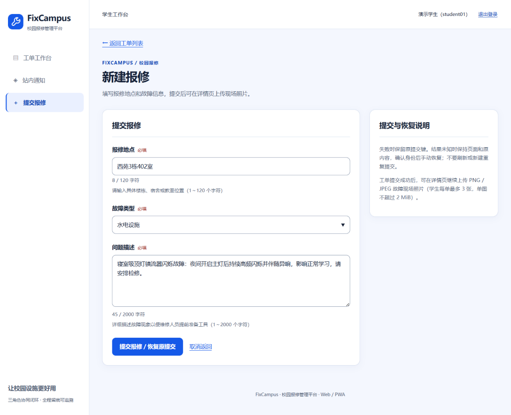
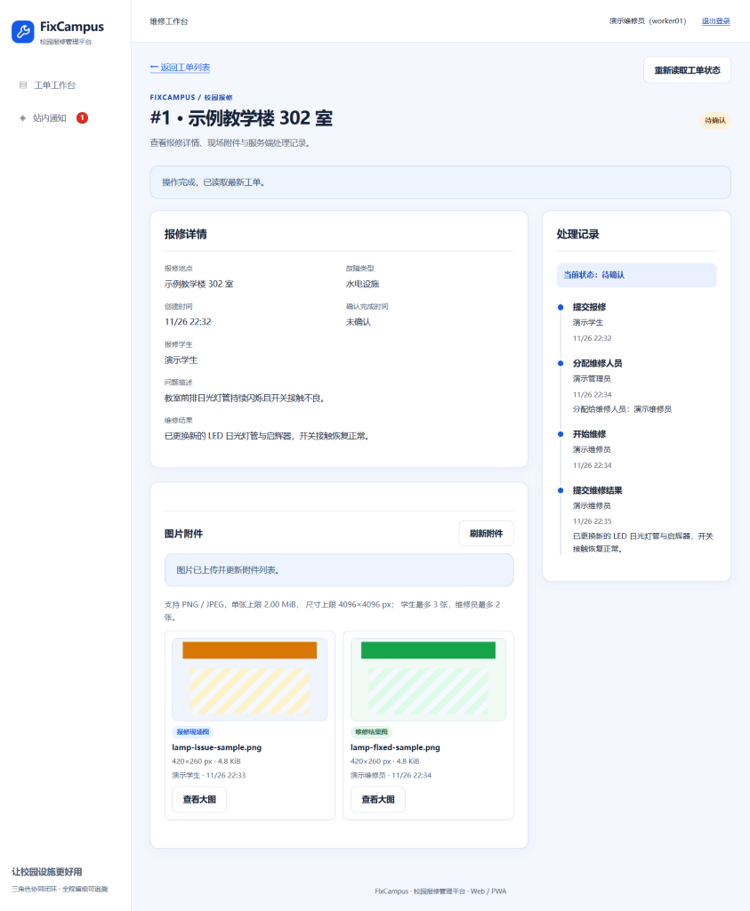
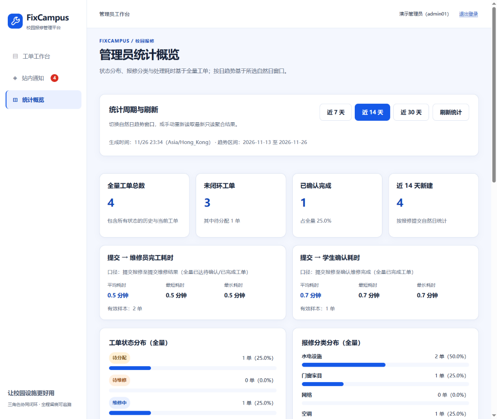

# FixCampus · 校园报修管理平台

面向高校后勤报修场景的全栈 Web/PWA 应用：学生提交报修并上传故障图片，管理员查看统计并派单，维修人员接单处理并上传完工照片，学生收到站内通知后确认完成。三角色共享同一套 React 前端与 Spring Boot / MySQL 后端。

[运行真实工作台](docs/portfolio/WEB-DEMO.md#运行真实工作台) · [三角色全流程演示](docs/portfolio/WEB-DEMO.md#走完一张工单) · [架构与 API](docs/portfolio/WEB-DEMO.md#架构与-api) · [界面预览](#界面预览真实隔离环境实机截图) · [系统架构图](docs/portfolio/SYSTEM-DIAGRAMS.md) · [工程设计说明](docs/portfolio/ENGINEERING-STORY.md) · [性能基准](docs/benchmark.md)

## 体验入口

| 入口 | 可以体验什么 |
| --- | --- |
| **真实工作台** `/app/` | 使用预置三角色账号登录，完整体验报修提交、图片附件上传与预览、管理员统计与派单、维修完工、站内通知与学生确认，数据持久化在 MySQL |
| **PWA 应用壳** | 从本机生产构建安装桌面/移动应用壳，重开继续连接同一后端；断网可打开应用壳，真实业务读写需要联网 |
| **演示模式构建** `npm run build:demo` | 在登录页展示预置演示账号名与「演示数据会定期清空」说明，标准生产构建默认隐藏 |
| **Mock 快速预览** `npm run dev:mock` | 无需数据库即可离线预览界面、虚构数据与错误态，与生产/演示构建严格隔离 |

当前交付平台为桌面与移动浏览器的 Web/PWA，真实演示通过本地隔离 MySQL 启动。公网部署、Windows 原生桌面版与 Android 原生版留待后续阶段。

## 界面预览（真实隔离环境实机截图）

以下七张截图均采自本仓库源码在隔离 MySQL 8.4.11（Flyway `V1～V6`）+ Spring Boot `web-slice` + React 生产构建上的真实三角色运行画面。所有账号（`student01` / `admin01` / `worker01`）、工单内容与示例图片均为**虚构测试数据**，PNG 已剥离非必需元数据块，不代表线上生产部署。

| 统一登录入口 | 学生新建报修单 |
| --- | --- |
|  |  |

| 管理员多状态工单工作台 | 学生站内通知中心与未读角标 |
| --- | --- |
|  |  |

| 学生工单详情与故障图片附件 | 维修人员完工结果与双角色附件 |
| --- | --- |
|  |  |

### 管理员统计概览与两类独立耗时

## 核心功能与工程设计

- **角色鉴权、对象归属与演示加固**：基于 Spring Security 服务端 Servlet Session、CSRF 与同源 `Origin` 校验，并在鉴权之后由进程内限流保护登录及显式业务写路由（建单、状态流转、附件上传/删除、通知已读，超限返回 `429`；退出登录不计入限流）。跨角色路径返回 `403`，越权访问他人工单、附件或通知统一返回 `404`。`web-slice` / `demo` / `prod` Profile 默认关闭注册、禁止改密，并提供双重显式开关保护的演示库重置服务（数据库层单事务重置，文件层在提交后清理）。
- **并发状态机、持久化幂等与同事务通知**：状态流转（`PENDING_ASSIGNMENT → PENDING_REPAIR → IN_PROGRESS → PENDING_CONFIRMATION → COMPLETED` 及待分配 `CANCELLED`）在 `@Transactional` 中加悲观行锁（`PESSIMISTIC_WRITE`，会话锁等待超时 3 秒返回 `503`，业务冲突返回 `409`），同事务写入 `order_events` 与带唯一幂等键的 `notifications`。新建报修支持 `Idempotency-Key` 持久化恢复，响应丢失后可安全重发而不重复建单。
- **安全图片附件（纯 JDK ImageIO）**：仅允许 `PNG` / `JPEG` 魔数，解码前预检宽高与总像素防解压炸弹，完整解码后剥离 EXIF 重新编码落盘；通过进程内写串行化与工单行锁校验单工单上限与全局配额，提交/回滚回调清理磁盘文件并对失败删除入队补偿，跨角色按工单归属安全预览。
- **管理员统计面板**：在只读事务内通过 SQL 聚合输出全量状态分布、报修分类分布、7/14/30 天按日趋势，严格区分「提交 → 维修完工」与「提交 → 学生确认」两种耗时，并在 API 契约中诚实声明自由文本地点暂不做区域聚合的边界。
- **数据库分页优化与可观测性**：单机 10 万条工单对照基准中，管理员无筛选末页延迟从 123.02 ms 降至 39.88 ms（P95，4 并发槽，每场景 120 样本），[测量条件与复现指令](docs/benchmark.md)。全链路透传 `X-Request-Id` 与脱敏日志关联。

技术栈为 React 19、TypeScript、Vite、Java 25、Spring Boot 3.5、Spring Security、Spring Data JPA / JDBC、Flyway（`V1～V6`）与 MySQL 8.4。本仓库通过 [GitHub Actions CI](.github/workflows/ci.yml) 在隔离 MySQL 8.4.11 容器与 Node 24 环境下持续验证全量后端测试（457 项）与前端质量检查（160 项 + 标准构建），每次运行的测试与 JaCoCo 覆盖率产物均可在 Actions 页面公开复核。

## 软件工程标准文档

- [软件需求规格说明书（SRS）](docs/se/01-REQUIREMENTS-SPECIFICATION.md) — 系统范围边界、角色权限矩阵、用例图与 9 项核心用例规约、功能/非功能需求清单
- [系统概要与详细设计说明书](docs/se/02-SYSTEM-AND-DATABASE-DESIGN.md) — 分层模块结构、领域类图、Flyway `V1～V6` 六表逐列数据字典、`/api/v1` 完整接口与错误码规范
- [软件测试计划与测试报告](docs/se/03-TEST-PLAN-AND-REPORT.md) — 分层测试策略、需求-测试用例追踪矩阵（RTM）、核心实测结论与覆盖率汇总
- [用户操作手册与部署运维指南](docs/se/04-USER-AND-DEPLOYMENT-MANUAL.md) — 三角色操作指引、PWA 安装与异常恢复、完整环境变量字典与故障排查
- [开发过程、迭代记录与项目总结](docs/se/05-DEVELOPMENT-PROCESS-AND-ITERATION-LOG.md) — 迭代开发与质量门禁治理、WBS 交付记录、工程风险复盘与个人/AI 分工说明

## 个人贡献

个人主导、AI 辅助开发。主要工作包括拆分三角色业务与验收路径、确定权限/归属与 MySQL 事务边界、设计幂等恢复/附件校验/同事务通知/统计口径、定位深分页开销，以及复核真实浏览器与 PWA 行为。[设计决策与面试说明](docs/portfolio/WEB-DEMO.md#设计决策与面试说明)

[本地运行指南](docs/technical/LOCAL-RUN.md) · [系统架构与数据模型](docs/technical/ARCHITECTURE.md) · [实现与测试依据](docs/technical/IMPLEMENTATION.md) · [第三方许可](docs/technical/THIRD-PARTY.md)
