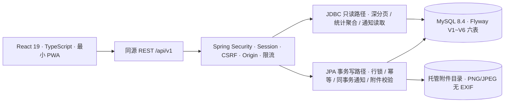
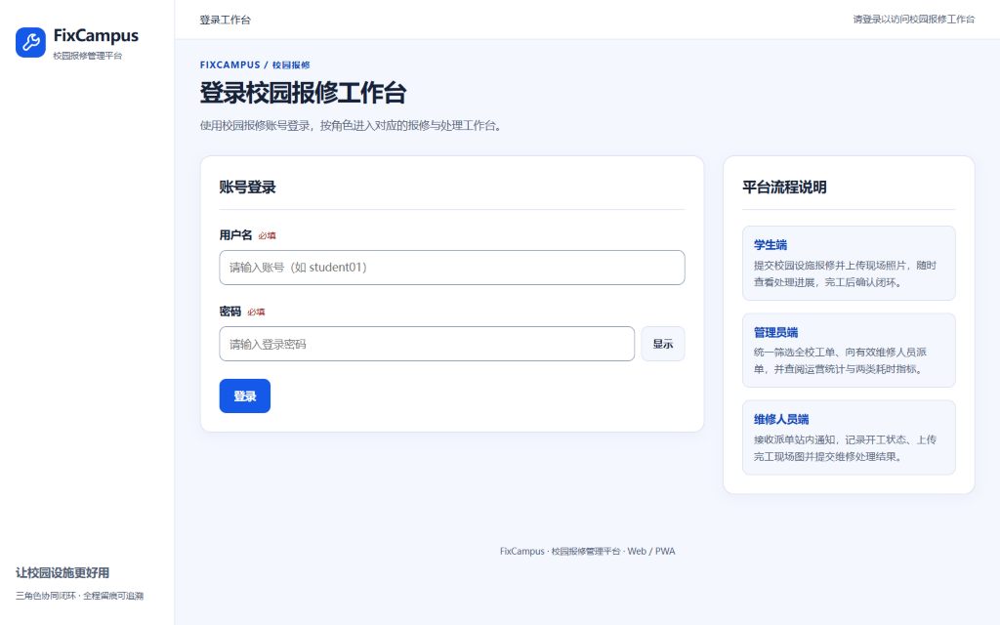
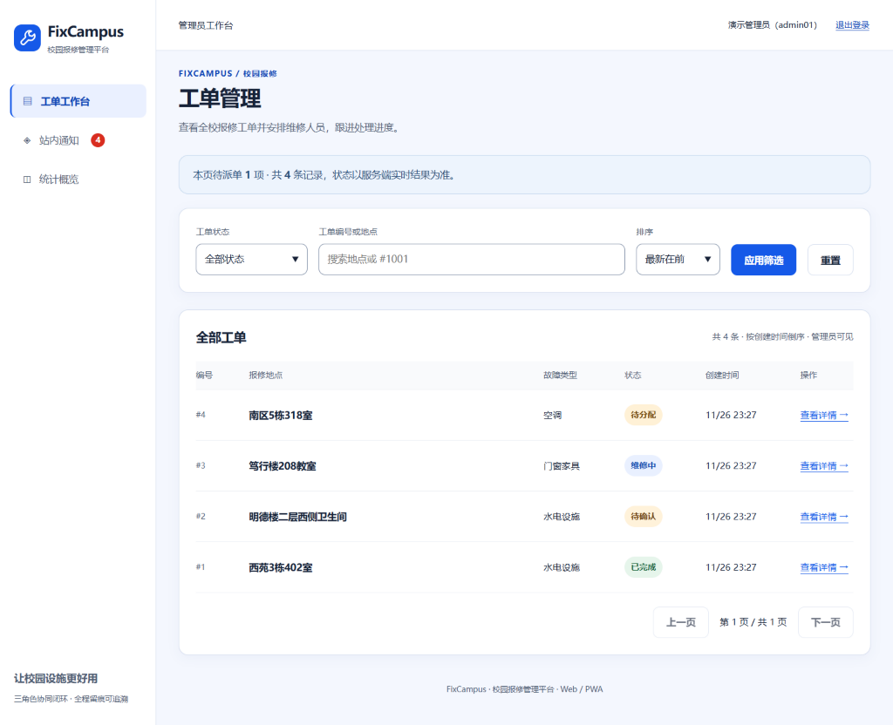
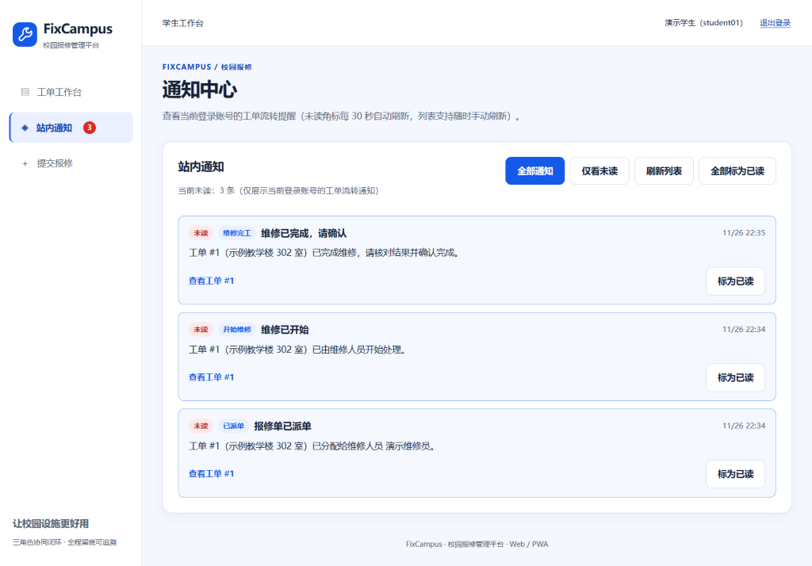
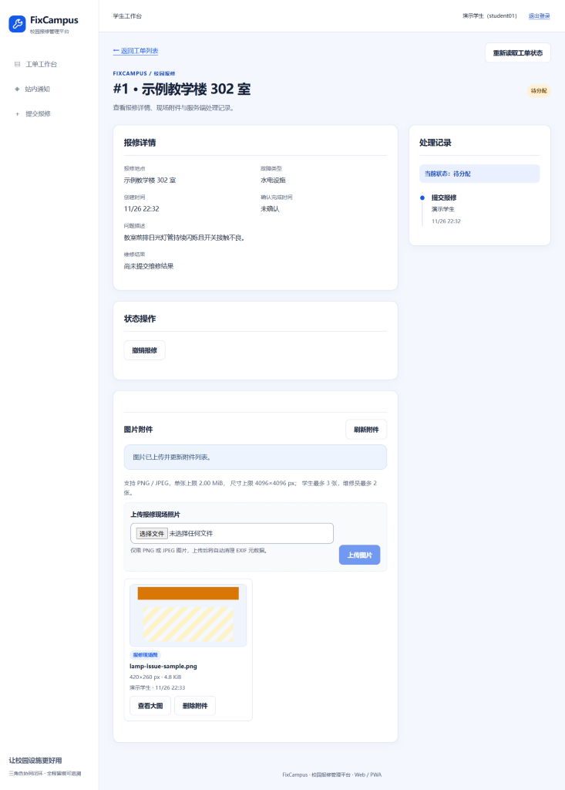

# FixCampus · 校园报修管理平台

[](https://github.com/lifuxiaojiedegou/FixCampus-Showcase/actions/workflows/ci.yml)

面向高校后勤报修场景的全栈 Web/PWA 应用，支持**学生提交报修与传图 → 管理员统计与派单 → 维修人员接单处理与传完工照 → 学生收到站内通知并确认完成**的三角色完整闭环。

[系统架构](#系统架构) · [界面预览](#界面预览) · [核心特性](#核心特性) · [技术栈与验证](#技术栈与验证) · [本地运行](#本地运行) · [项目文档](#项目文档)

---

## 系统架构



> 完整分层架构图、三角色状态机与关键时序图见 [系统架构图与时序图](docs/portfolio/SYSTEM-DIAGRAMS.md)。

---

## 界面预览

以下截图采自本机隔离 MySQL 8.4 + React 生产构建运行环境（账号与工单均为测试数据）：

| 统一登录入口 | 学生新建报修单 |
| --- | --- |
|  |  |

| 管理员多状态工单工作台 | 学生站内通知中心与未读角标 |
| --- | --- |
|  |  |

| 学生工单详情与故障图片附件 | 维修人员完工结果与双角色附件 |
| --- | --- |
|  |  |

### 管理员统计概览与两类独立耗时


---

## 核心特性

- **三角色权限隔离与会话防护**：基于 Spring Security 服务端 Session、`HttpOnly` / `SameSite=Lax` Cookie、CSRF 与同源 `Origin` 校验，并内置登录与业务写路由限流（`429`）；跨角色访问返回 `403`，越权访问他人工单、附件或通知统一返回 `404`。
- **并发状态机与持久化幂等**：六状态单向流转（`PENDING_ASSIGNMENT → PENDING_REPAIR → IN_PROGRESS → PENDING_CONFIRMATION → COMPLETED` 及待分配 `CANCELLED`）均在 `@Transactional` 中以 `PESSIMISTIC_WRITE` 悲观行锁保护（`innodb_lock_wait_timeout = 3s`，锁超时返回 `503`，状态冲突返回 `409`）；新建报修支持 `Idempotency-Key` 持久化去重与断网安全恢复。
- **零外部依赖图片附件安全处理**：纯 JDK `ImageIO` 校验 PNG/JPEG 魔数与宽高/总像素上限，解码后剥离 EXIF 重编码落盘；结合写串行化与行锁管控单工单张数与全局配额，事务提交/回滚回调自动清理磁盘文件。
- **同事务站内通知与管理员统计**：工单状态变更同事务写入带确定性幂等键的 `notifications`，前端提供未读角标与 30 秒轮询；管理员统计面板通过只读 SQL 聚合输出状态/分类分布、7/14/30 天趋势及「提交 → 维修完工」「提交 → 学生确认」两类独立耗时。
- **深分页优化与最小 PWA 应用壳**：10 万条工单末页延迟关联优化使 P95 由 **123.02 ms 降至 39.88 ms**（[性能基准](docs/benchmark.md)）；Service Worker 仅预缓存静态应用壳，业务 API 始终走网络，避免跨账号数据残留。

---

## 技术栈与验证

| 层级 | 技术选型 |
| --- | --- |
| 前端 | React 19 · TypeScript · Vite · CSS Modules · PWA (Service Worker / Manifest) |
| 后端 | Java 25 · Spring Boot 3.5 · Spring Security · Spring Data JPA / JDBC |
| 数据库与迁移 | MySQL 8.4 · Flyway (`V1～V6` 六表模型) |
| 自动化测试与 CI | GitHub Actions（隔离 MySQL 8.4 容器后端 **457 项测试** + JaCoCo 覆盖率；前端 **160 项 Vitest** + TS + ESLint + Prettier + 构建，见 [CI 工作流](.github/workflows/ci.yml)） |

---

## 本地运行

### 方式一：Docker Compose 一键启动（跨平台推荐，无需本机安装 JDK / Node / MySQL）

```bash
cp .env.example .env    # 将 .env 中的 REPLACE_WITH_* 替换为自定义本机密码（8～64 字符，三个演示账号密码须互不相同）
docker compose up --build
```

等待容器就绪后访问 `http://127.0.0.1:5173/app/`，即可使用预置三角色账号（`student01` / `admin01` / `worker01`）与 `.env` 中设置的密码体验完整业务。停止并清空演示数据：`docker compose down -v`。

### 方式二：本机原生运行 / 纯前端 Mock

- **本机完整全栈运行（JDK 25 + Node 24 + MySQL 8.4）**：详见 [Web/PWA 启动与接口指南](docs/portfolio/WEB-DEMO.md)（支持 `scripts/run-web-slice.ps1` 自动执行 Flyway `V1～V6` 与预置演示账号初始化）。
- **离线纯前端预览（无需数据库）**：进入 `frontend/` 执行 `npm ci --ignore-scripts --no-audit --no-fund` 后运行 `npm run dev:mock`。

---

## 项目文档

- **架构与设计**：[系统架构与六表数据模型](docs/technical/ARCHITECTURE.md) · [系统架构图与时序图](docs/portfolio/SYSTEM-DIAGRAMS.md) · [工程设计说明](docs/portfolio/ENGINEERING-STORY.md) · [实现与测试索引](docs/technical/IMPLEMENTATION.md) · [深分页性能基准](docs/benchmark.md)
- **软件工程文档**：[需求规格说明书](docs/se/01-REQUIREMENTS-SPECIFICATION.md) · [概要与详细设计](docs/se/02-SYSTEM-AND-DATABASE-DESIGN.md) · [测试计划与报告](docs/se/03-TEST-PLAN-AND-REPORT.md) · [用户与部署手册](docs/se/04-USER-AND-DEPLOYMENT-MANUAL.md) · [开发过程与迭代总结](docs/se/05-DEVELOPMENT-PROCESS-AND-ITERATION-LOG.md)
- **运行与许可**：[本地运行与全量测试指南](docs/technical/LOCAL-RUN.md) · [前端说明](frontend/README.md) · [第三方许可](docs/technical/THIRD-PARTY.md)
