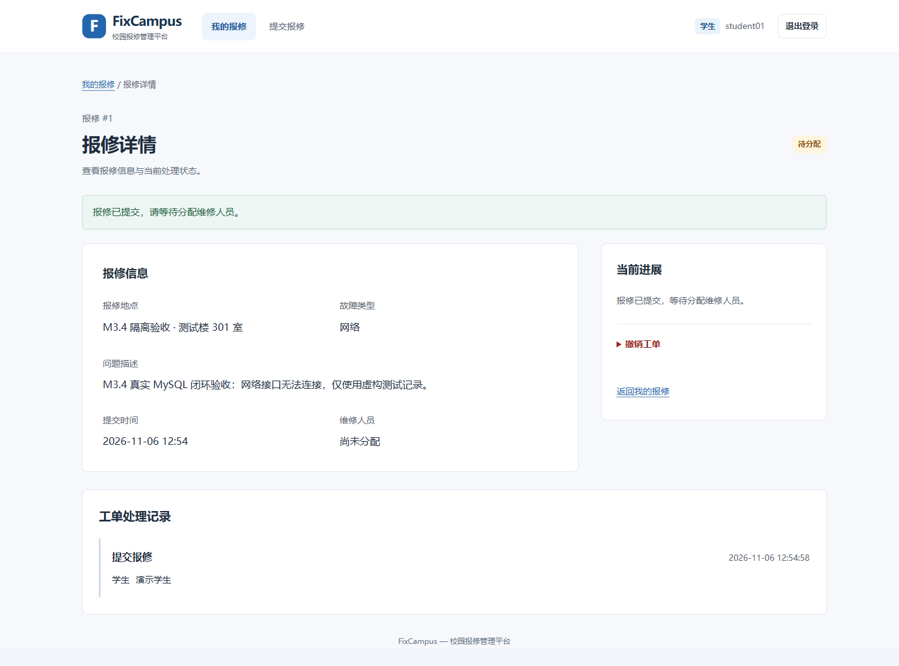
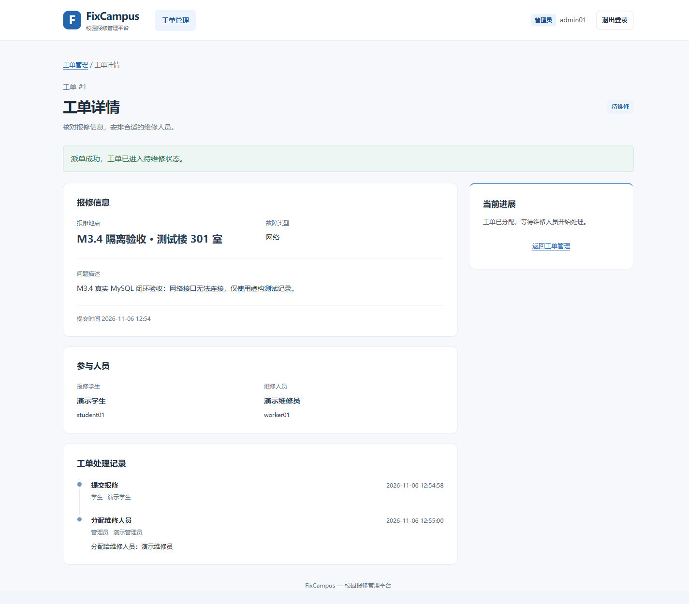
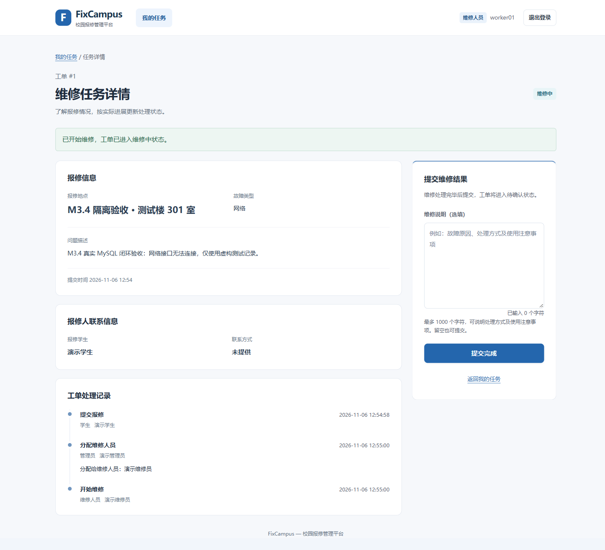
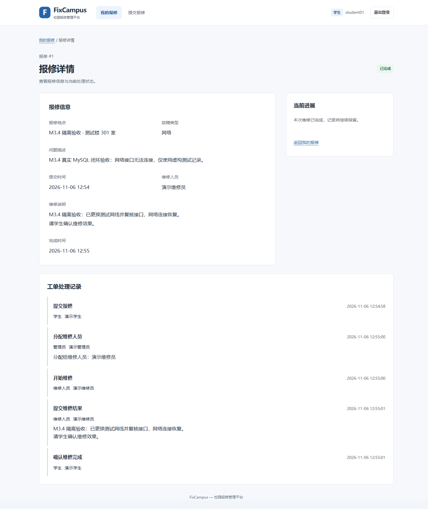

# FixCampus · 校园报修管理平台

一个面向校园设施报修场景的 **Spring Boot 分层单体应用**。学生提交报修、管理员分配维修人员、维修人员处理工单，最后由学生确认完成，形成可回溯的业务闭环。

这是**个人主导、使用 AI 辅助开发和文档整理**的工程实践项目，用于展示业务建模、访问控制、并发一致性、数据库约束和自动化验证；不宣称为多人团队产品，也不宣称已在学校生产环境部署。

[业务流程](#业务流程与角色) · [界面截图](#界面截图) · [设计与验证](#设计与验证) · [本地运行](#本地运行)

## 业务流程与角色

```text
学生提交 → 待分配 → 管理员派单 → 待维修 → 开始维修 → 维修中 → 提交结果 → 待确认 → 学生确认 → 已完成
             └── 学生可在待分配时撤销本人报修 → 已取消
```

| 角色 | 已实现功能 |
| --- | --- |
| 学生 | 注册、登录、提交报修、查看本人工单、搜索和筛选、撤销待分配工单、确认维修结果 |
| 管理员 | 查看全部工单、搜索与筛选、分配有效维修人员、查看处理进度 |
| 维修人员 | 查看本人任务、搜索与筛选、开始维修、提交处理说明 |

工单记录提交、派单、处理、提交结果、确认或取消等事件，详情页面展示处理时间线；只有学生确认后才记为已完成。

## 界面截图

以下四张图片来自实际运行的应用和独立 MySQL 测试库，账号、地点及工单内容均为**虚构验收数据**，不代表真实校园用户或线上部署。

| 学生：提交报修 | 管理员：分配维修人员 |
| --- | --- |
|  |  |

| 维修人员：处理工单 | 学生：确认完成 |
| --- | --- |
|  |  |

## 技术栈

| 层次 | 技术 |
| --- | --- |
| 后端 | Java 25、Spring Boot 3.5.16、Spring MVC |
| 登录和授权 | Spring Security、Session、CSRF、PBKDF2 |
| 页面 | Thymeleaf、HTML、CSS、原生 JavaScript |
| 数据 | Spring Data JPA、Hibernate、MySQL 8.4.11 / InnoDB |
| 构建与测试 | Maven Wrapper（Maven 3.9.16）、JUnit 5、Spring Boot Test、JaCoCo 0.8.16、GitHub Actions |

## 设计与验证

- **角色和对象级权限：** Spring Security 控制三类角色入口；Repository 查询携带本人范围，Service 写入时再次核验工单归属、角色和最新状态。
- **并发状态一致性：** 工单修改使用事务和数据库悲观行锁；状态变更与 `order_events` 事件写入同一事务，拒绝不合法状态流转及重复操作。
- **服务端数据边界：** Controller 使用明确的表单字段与校验；普通注册只能创建学生，业务字段由服务端决定；页面由 Thymeleaf 服务端渲染。
- **测试覆盖：** 关键集成测试使用隔离的真实 MySQL，覆盖角色边界、状态流转、并发竞争、事务回滚等；部分故障响应使用定向 Mock 测试。

本仓库通过 GitHub Actions 在 `main` 推送及手动触发时执行 JDK 25 / MySQL 8.4.11 下的完整 `clean verify`，并保存 Surefire、JaCoCo 报告。实际测试结果、覆盖率和执行记录以 [GitHub Actions](https://github.com/lifuxiaojiedegou/FixCampus-Showcase/actions) 为准。

进一步了解：[工程设计与验证](docs/portfolio/ENGINEERING-STORY.md) · [架构与流程图](docs/portfolio/SYSTEM-DIAGRAMS.md) · [技术实现导览](docs/technical/IMPLEMENTATION.md) · [系统架构与数据模型](docs/technical/ARCHITECTURE.md)。

## 本地运行

需准备 **JDK 25、MySQL 8.4.11、PowerShell** 和 MySQL 客户端。以 Windows 为例，使用只在本机保存的配置模板；**项目不提供共享默认密码**。

```powershell
New-Item -ItemType Directory -Path .local -Force
Copy-Item config/database.example.json .local/database.json
Copy-Item config/mysql-admin.example.ini .local/mysql-admin.ini
```

先按照[本地运行指南](docs/technical/LOCAL-RUN.md)创建专用 MySQL 账号、填写本地密码，再执行：

```powershell
./scripts/initialize-database.ps1 -AdminConfigPath .local/mysql-admin.ini
./scripts/verify-local.ps1
./scripts/run-local.ps1 -SkipBuild
```

默认访问 `http://localhost:8080/login`。管理员和维修人员的演示账号须显式开启并自行设置密码；不要让演示/测试库指向真实业务数据。

## 已知边界与演进方向

目前**没有**生产部署、容量/负载验证、分页、附件上传、通知、改派、返修或用户管理界面；创建报修**尚无服务端幂等键**。下一步优先考虑分页、创建请求幂等和失败恢复，再视需求评估附件及通知。

本仓以**源代码展示**为目的，不提供项目级开源许可证，不代表授权他人任意复制、修改、商用或再分发。Apache Maven Wrapper 等第三方材料遵循各自的许可证和归属要求，详见[第三方许可说明](docs/technical/THIRD-PARTY.md)。当前不计划公开可执行 JAR 或 Docker 镜像；若将来分发二进制文件，需要另行审查其依赖许可。
