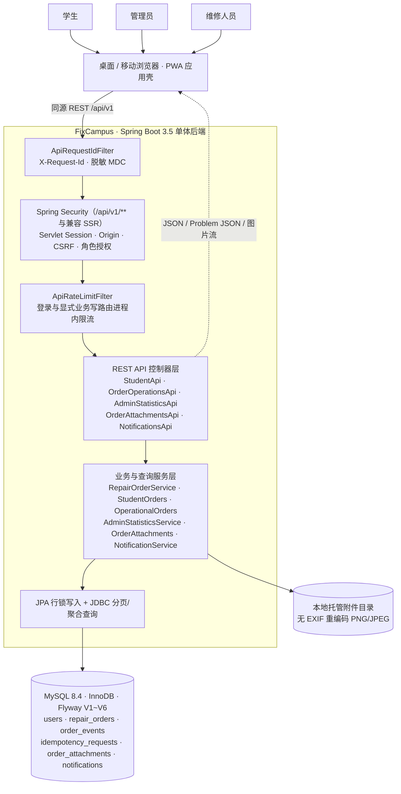
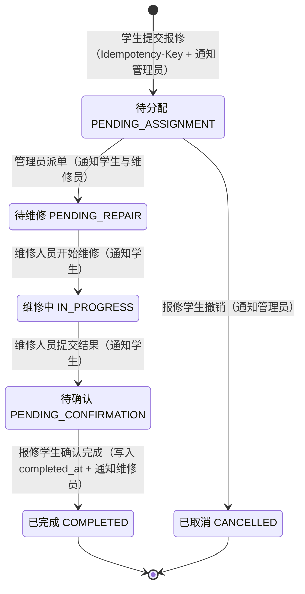
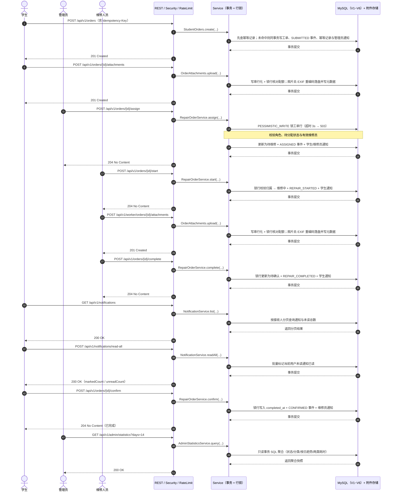

# FixCampus · 系统架构与业务流程图

这份文档依据当前源码与 Flyway `V1～V6` 数据库结构整理，展示实际实现的 Web/PWA 前后端分层单体架构、六状态工单状态机、三角色闭环事务边界及六表数据模型。图为**设计与代码关系示意**，并非多节点生产部署拓扑图；当前项目没有微服务、Redis 或消息队列。

返回 [项目 README](../../README.md) · 阅读 [Web/PWA 演示](WEB-DEMO.md) · [详细技术架构](../technical/ARCHITECTURE.md) · [实现与测试依据](../technical/IMPLEMENTATION.md)

## 一、系统分层架构

前端 React 19 SPA 挂载于 `/app/`，通过同源 `/api/v1` 访问后端；PWA Service Worker 仅缓存静态应用壳，绝不缓存认证与业务接口。后端入口先附加请求编号，再经 Spring Security 会话/Origin/CSRF/角色授权校验，随后由 `ApiRateLimitFilter` 对登录与显式业务写路由执行限流；读路径使用 JDBC 数据库分页与 SQL 聚合，写路径在 `@Transactional` 中使用 `PESSIMISTIC_WRITE` 锁定工单行并保持 `open-in-view=false`。原有 Thymeleaf SSR 路径保留兼容。

核心源码：[ApiSecurityConfig](../../src/main/java/com/fixcampus/api/v1/ApiSecurityConfig.java) · [ApiRateLimitFilter](../../src/main/java/com/fixcampus/api/v1/ApiRateLimitFilter.java) · [StudentApi](../../src/main/java/com/fixcampus/api/v1/StudentApi.java) · [OrderOperationsApi](../../src/main/java/com/fixcampus/api/v1/OrderOperationsApi.java) · [AdminStatisticsApi](../../src/main/java/com/fixcampus/api/v1/AdminStatisticsApi.java) · [OrderAttachmentsApi](../../src/main/java/com/fixcampus/api/v1/OrderAttachmentsApi.java) · [NotificationsApi](../../src/main/java/com/fixcampus/api/v1/NotificationsApi.java) · [RepairOrderService](../../src/main/java/com/fixcampus/service/RepairOrderService.java)。

## 二、工单状态流转

只有这六种状态；**开始维修**与**提交维修结果**是引发状态变化的操作，不是额外状态。撤销仅限未派单的本人工单，完成时间仅在学生最终确认时写入。学生可在待分配/待维修阶段上传故障图片（待分配可删本人上传），维修人员可在维修中上传完工图片。`COMPLETED` 与 `CANCELLED` 均为终态，当前不支持改派或返修。状态与事件枚举见 [RepairStatus](../../src/main/java/com/fixcampus/entity/RepairStatus.java) 与 [OrderAction](../../src/main/java/com/fixcampus/entity/OrderAction.java)。

## 三、三角色闭环与事务边界

时序图突出成功路径。各业务 HTTP 请求彼此独立：`StudentOrders.create` 在开启写事务前先查询既有幂等记录（重放命中直接返回原工单，并发同键冲突则在写事务回滚后再次查询）；既有工单的状态变更、事件和通知在各自的 `@Transactional` 边界内同事务提交；任一归属或状态校验失败返回 `404` 或 `409`，锁等待超时或数据库故障完整回滚数据库变更并返回 `503`。附件落盘后的磁盘清理通过事务提交/回滚回调执行，若文件系统删除失败则记录日志并入队补偿清理。

## 四、六表数据与设计边界

- `users` 保存三角色与登录身份；`repair_orders` 保存报修内容、学生、可选维修人员、状态和学生确认完成时间；`order_events` 保存动作、操作人角色/姓名快照与微秒时间；`idempotency_requests` 保存创建报修幂等键、请求摘要与结果工单；`order_attachments` 保存净化后图片元数据与随机存储键；`notifications` 保存接收人、事件类型、内容、已读时间与幂等键。
- 数据库外键、`CHECK` 约束、事件 `(order_id, action)` 唯一约束与通知 `idempotency_key` 唯一约束共同提供底层护栏；事件与通知属于**业务处理记录**，不宣称为数据库级不可篡改审计日志。
- 当前不支持工单改派、返修、地点结构化区域聚合与多节点部署；如果未来扩展分支流转，应先重新评估事件唯一约束与通知幂等键规则。

数据库迁移依据：[V1 用户](../../src/main/resources/db/migration/V1__create_users.sql) · [V2 工单](../../src/main/resources/db/migration/V2__create_repair_orders.sql) · [V3 事件](../../src/main/resources/db/migration/V3__create_order_events.sql) · [V4 幂等](../../src/main/resources/db/migration/V4__create_idempotency.sql) · [V5 附件](../../src/main/resources/db/migration/V5__create_order_attachments.sql) · [V6 通知](../../src/main/resources/db/migration/V6__create_notifications.sql)。
