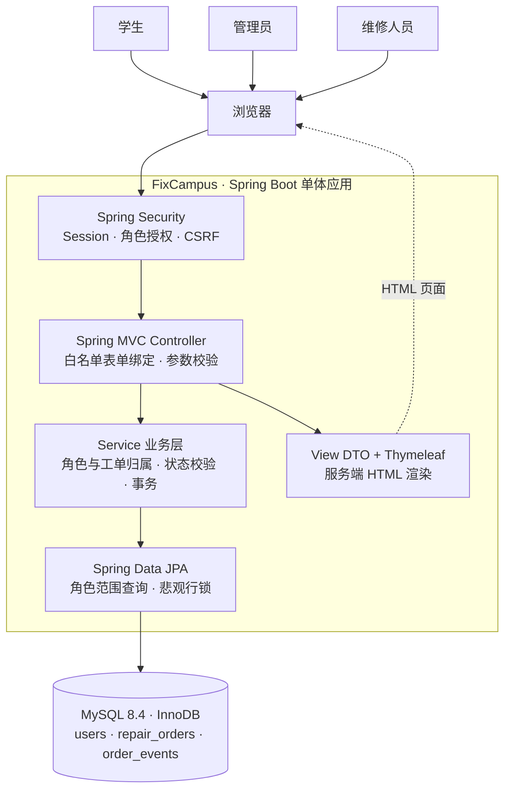
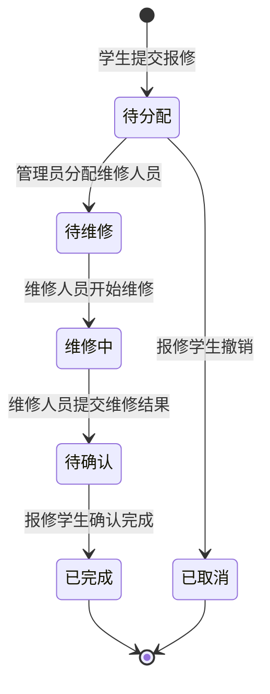
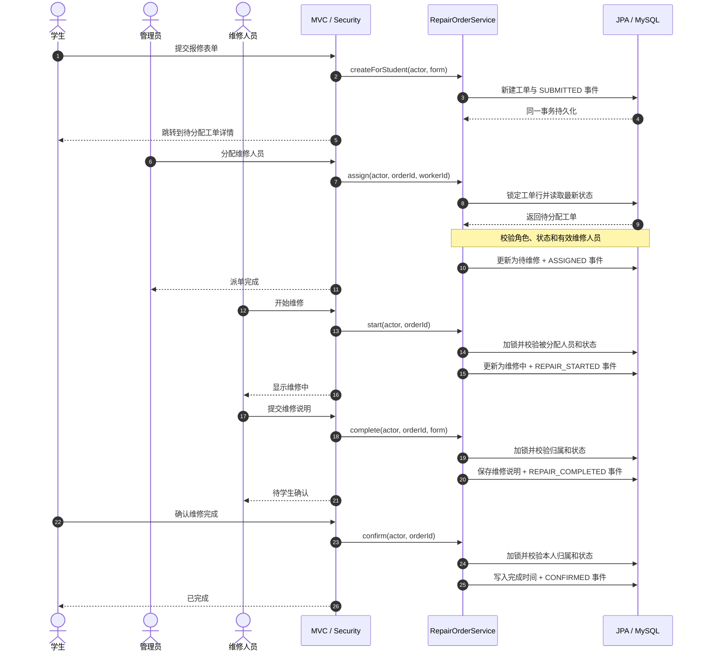

# FixCampus · 系统架构与业务流程图

这份作品集文档依据 `main` 分支的现有源码与数据库结构整理，展示实际实现的分层单体架构、工单状态机和三角色业务闭环。图为**设计与代码关系示意**，并非生产部署拓扑图；当前项目没有微服务、Redis、消息队列或生产部署。

返回 [项目 README](../../README.md) · 阅读 [详细技术架构](../technical/ARCHITECTURE.md) · [实现与测试依据](../technical/IMPLEMENTATION.md)

## 一、系统分层架构

浏览器提交表单后，Spring Security 校验会话、角色入口和 CSRF；Controller 只绑定允许字段。`RepairOrderService` 验证操作者角色、工单归属和业务状态，持有事务；Repository 执行带身份范围的查询及 `PESSIMISTIC_WRITE` 锁定读取。Controller 使用服务层组装的视图 DTO 由 Thymeleaf 渲染，`open-in-view=false`。

源码入口：[SecurityConfig](../../src/main/java/com/fixcampus/config/SecurityConfig.java) · [StudentController](../../src/main/java/com/fixcampus/controller/StudentController.java) · [AdminController](../../src/main/java/com/fixcampus/controller/AdminController.java) · [WorkerController](../../src/main/java/com/fixcampus/controller/WorkerController.java) · [RepairOrderService](../../src/main/java/com/fixcampus/service/RepairOrderService.java) · [RepairOrderRepository](../../src/main/java/com/fixcampus/repository/RepairOrderRepository.java)。

## 二、工单状态流转

只有这六种状态；**开始维修**与**提交维修结果**是引发状态变化的操作，不是额外状态。撤销仅限未派单的本人工单，完成时间仅在学生最终确认时写入。`COMPLETED` 与 `CANCELLED` 均为终态，当前不支持改派或返修。状态相关枚举见 [RepairStatus](../../src/main/java/com/fixcampus/entity/RepairStatus.java) 与 [OrderAction](../../src/main/java/com/fixcampus/entity/OrderAction.java)。

## 三、三角色闭环与事务边界

时序图突出成功路径，省略了 Controller 的模板渲染细节。**已存在工单的状态变更**在 `@Transactional` 中用悲观行锁获取最新状态，并在同一事务保存工单及 `order_events`；无权访问的工单按业务规则隐藏，非法状态流转返回冲突，数据库异常不返回成功提示。新建报修尚无服务端幂等键，因此不能宣称网络重试不会重复创建工单。

## 四、数据与设计边界

- `users` 保存角色和登录身份；`repair_orders` 保存报修内容、学生、可选维修人员、状态和完成时间；`order_events` 保存业务动作、操作人及时间快照。
- 数据库外键、CHECK 和事件 `(order_id, action)` 唯一约束辅助维护一致性；这些记录是**业务处理历史**，不能宣称为数据库级不可篡改审计日志。
- 不支持工单改派、返修、附件、通知及生产部署；如果未来扩展分支流转，应先重新评估事件唯一约束与状态规则。

数据库结构依据：[工单表 DDL](../../database/002-repair-orders.sql) · [事件表 DDL](../../database/004-order-events.sql)；事务实现依据：[RepairOrderService](../../src/main/java/com/fixcampus/service/RepairOrderService.java)。
