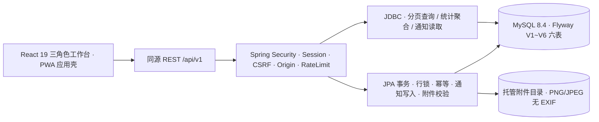

# FixCampus Web/PWA 演示

真实工作台使用 Spring Boot 和 MySQL。以下 Windows 回环演示用独立 MySQL 实例和三个虚构账号。Node 24、npm 11、JDK 25、MySQL 8.4.11 与 PowerShell 为这条路径的运行环境。

## 运行真实工作台

### 1. 准备隔离数据库

使用独立的本机 MySQL 8.4.11 实例，例如绑定回环的 13306 端口。仅在独立实例中执行下列 SQL。示例在 MySQL 默认的 `partial_revokes=OFF` 下用反斜杠转义库名中的下划线，确保授权只匹配这个 schema。若实例设置为 `ON`，将两条 `GRANT` 中的库名换成无反斜杠的完整库名。创建用户前，把两个占位密码换成各自不同的本地密码。

```sql
CREATE DATABASE fixcampus_m421_portfolio_test
  CHARACTER SET utf8mb4 COLLATE utf8mb4_0900_ai_ci;
CREATE USER 'portfolio_app'@'127.0.0.1' IDENTIFIED BY 'REPLACE_WITH_APP_PASSWORD';
CREATE USER 'portfolio_migration'@'127.0.0.1' IDENTIFIED BY 'REPLACE_WITH_MIGRATION_PASSWORD';
GRANT SELECT, INSERT, UPDATE, DELETE
  ON `fixcampus\_m421\_portfolio\_test`.* TO 'portfolio_app'@'127.0.0.1';
GRANT SELECT, INSERT, UPDATE, DELETE, CREATE, ALTER, INDEX, REFERENCES
  ON `fixcampus\_m421\_portfolio\_test`.* TO 'portfolio_migration'@'127.0.0.1';
```

从源码根目录执行（支持无 `.git` 的干净导出目录）。已有同名本地配置时先保留原件。

```powershell
New-Item -ItemType Directory -Path .local -Force
if (-not (Test-Path -LiteralPath .local/portfolio-accounts.json)) {
    Copy-Item config/demo-accounts.example.json .local/portfolio-accounts.json
}
```

在 Git 忽略的 `.local/` 中创建 `portfolio-db.json`，把两个 `null` 换成相应的密码字符串，并核对端口与库名。

```json
{
  "port": 13306,
  "database": "fixcampus_m421_portfolio_test",
  "username": "portfolio_app",
  "password": null,
  "migrationUsername": "portfolio_migration",
  "migrationPassword": null
}
```

在 `.local/portfolio-accounts.json` 中把 `enabled` 改为 `true`，给三个账号各设一个不同的 8～64 字符密码。若复用曾经启动过的隔离库，初始化器保留已存在的账号和密码。

### 2. 启动后端和 Web

后台终端，从源码根目录启动：

```powershell
.\scripts\run-web-slice.ps1 -ConfigPath .local/portfolio-db.json -DemoConfigPath .local/portfolio-accounts.json
```

Flyway `V1～V6` 自动初始化空 schema（`users`、`repair_orders`、`order_events`、`idempotency_requests`、`order_attachments`、`notifications`），应用再创建三个演示账号。应用默认只监听 `127.0.0.1:18080`。附件默认存储在系统临时目录下按库名隔离的子目录，也可通过 `FIXCAMPUS_ATTACHMENT_STORAGE_DIR` 指定托管目录。

前端终端，从源码根目录执行：

```powershell
Set-Location frontend
npm ci --ignore-scripts --no-audit --no-fund
npm run build
npm run preview:web
```

打开 [真实三角色工作台](http://127.0.0.1:5173/app/)。访问根路径 `/` 会由后端重定向至 `/app/`，旧 `/app/real/` 路径会回到工作台首页。构建预览提供同源 `/api/v1` 代理，Edge 安装后的入口也是 `/app/`。开发时可用 `npm run dev:web`。只看 Mock 时，单独运行 `npm run dev:mock`，用同一地址打开 Mock。

用 `npm run build:demo` 和 `npm run preview:demo` 预览演示账号说明和定期清空提示。`VITE_DEMO_ACCESS_HINT` 与 `VITE_DEMO_RESET_NOTICE` 在构建时读入，只填写公开显示的说明文字；账号密码使用上述本地服务端配置。标准构建隐藏演示说明。

`web-slice`、`demo` 和 `prod` Profile 默认关闭注册、禁止改密并启用进程内限流。演示库定时重置采用双重显式开关（同时开启 `FIXCAMPUS_DEMO_ENABLED=true` 与 `FIXCAMPUS_DEMO_RESET_ENABLED=true` 才注册调度器，默认均关闭）；当前本机指南只初始化预置账号，公网部署与线上 HTTPS 验收待后续单独开展。

## 走完一张工单

每次换角色先退出；也可以为三个账号分别使用隔离的浏览器配置。

| 顺序 | 账号 | 操作与观察 |
| --- | --- | --- |
| 1 | `student01` | 点击「提交报修」，填写“示例教学楼 302 室 / 水电设施 / 教室前排日光灯管持续闪烁且开关接触不良”，提交后在详情页上传 1 张 PNG/JPEG 故障图片；详情显示待分配、处理记录与图片预览（可另建一单体验待分配撤销） |
| 2 | `admin01` | 登录后工作区导航可见「站内通知」未读角标；打开工单详情并派单给 `演示维修员`；状态变为待维修 |
| 3 | `worker01` | 登录后查看未读派单通知；打开待办工单，点击「开始维修」，上传 1 张维修后照片，填写维修说明后「提交维修结果」；状态变为待确认，双角色附件均可见 |
| 4 | `student01` | 登录后工作区导航显示未读角标，进入「站内通知」（`/app/notifications`）核对派单/开工/完工通知并点击「全部标为已读」，再跳回工单点击「确认维修完成」；刷新后仍保持已完成、5 条时间线与 2 张图片附件 |
| 5 | `admin01` | 进入「统计概览」（`/app/stats`），切换近 7/14/30 天窗口，核对全量状态分布、分类分布、按日趋势及两类独立耗时（「提交 → 维修完工」与「提交 → 学生确认」） |

验证未知结果恢复时，保留当前页面和原表单；网络恢复后先按提示点击「重新确认身份／CSRF」（若出现恢复条），再手动点击「提交报修／恢复原提交」。订单创建的幂等键随原请求重发，避免第二张工单。派单、维修和确认等状态操作结果不明时，先刷新详情核对状态和时间线。

## 架构与 API



| 功能 | `/api/v1` 下的路径 |
| --- | --- |
| 登录态 | `GET /auth/csrf`、`POST /auth/login`、`GET /me`、`POST /auth/logout` |
| 学生工单 | `GET /orders`、`GET /orders/{id}`、`POST /orders` |
| 管理员与统计 | `GET /admin/orders`、`GET /admin/orders/{id}`、`GET /admin/workers`、`GET /admin/statistics?days=7\|14\|30` |
| 维修人员工单 | `GET /worker/orders`、`GET /worker/orders/{id}` |
| 工单动作 | `POST /orders/{id}/assign`、`/start`、`/complete`、`/confirm`、`/cancel` |
| 图片附件 | `GET/POST /orders/{id}/attachments`、`DELETE /orders/{id}/attachments/{aid}`、`GET/POST /worker/orders/{id}/attachments`、`GET /admin/orders/{id}/attachments` 及各角色前缀 `/{aid}/content` |
| 站内通知 | `GET /notifications`、`GET /notifications/unread-count`、`POST /notifications/{id}/read`、`POST /notifications/read-all` |

写请求使用当前会话的 CSRF 响应所给出的头名与令牌，并核对同源 `Origin`。创建工单另带 `Idempotency-Key` UUID v4，提交 `location`、`category` 和 `description`，成功返回 `201` 与工单 ID。列表支持从 `0` 开始的 `page`、`size`、`sort`、`status` 与 `q`。所有接口响应透传 `X-Request-Id` 关联故障反馈和脱敏服务端日志。

核心接口源码：[StudentApi](../../src/main/java/com/fixcampus/api/v1/StudentApi.java) · [OrderOperationsApi](../../src/main/java/com/fixcampus/api/v1/OrderOperationsApi.java) · [AdminStatisticsApi](../../src/main/java/com/fixcampus/api/v1/AdminStatisticsApi.java) · [OrderAttachmentsApi](../../src/main/java/com/fixcampus/api/v1/OrderAttachmentsApi.java) · [NotificationsApi](../../src/main/java/com/fixcampus/api/v1/NotificationsApi.java)

## 常见故障

| 现象 | 核对项 |
| --- | --- |
| 5173 或 18080 被占用 | 查看对应端口是否已有自己的开发终端，停止冲突的本地实例后再启动 |
| Flyway 拒绝迁移或登录后出现 503 | 核对库名（须匹配 `fixcampus_m421_*_test`）、回环端口、DML/迁移账号和权限。空库交给 Flyway `V1～V6` 初始化，旧 SSR 建表脚本用于另一路径 |
| 找不到演示账号或密码不匹配 | 核对显式演示配置和首次初始化时的密码，既有账号不会被覆盖 |
| 预览能打开但无法登录 | 用 `preview:web`、`preview:demo` 或 `dev:web`，并统一打开 `127.0.0.1:5173`。普通 `preview` 只提供静态预览 |
| 图片附件上传返回 400 / 409 / 413 | 仅接受真实 PNG/JPEG 魔数，单图 ≤ 2 MiB、单边 ≤ 4096 px、总像素 ≤ 16M；学生每单最多 3 张（待分配/待维修），维修员每单最多 2 张（维修中），全局配额 64 MiB |
| 操作返回 429 | 等待限流窗口后手动操作。创建报修保留原表单和提交键，其他操作先核对最新工单状态 |
| 操作返回 503 | 用页面的请求编号定位故障（包括 3 秒 InnoDB 行锁等待超时回滚），稍后核对工单状态再操作；创建报修沿用原提交键 |
| 找不到 PWA 安装入口 | 使用生产构建的预览命令；实际部署用 HTTPS，将静态构建挂在 `/app/`，把 `/api/v1` 同源转发给应用 |
| 断网或更新期间仍有待确认操作 | 保留当前页面，联网后按原提交恢复或核对工单；核对完再关闭所有 FixCampus 窗口加载新版 |

## 设计决策与面试说明

- **同一工单双派单会发生什么？** JPA 写操作在事务中以 `PESSIMISTIC_WRITE` 锁定同一行，会话级 `innodb_lock_wait_timeout = 3` 防止连接池长期阻塞，后到请求按最新状态判断（业务冲突 `409`，锁等待超时完整回滚并返回 `503`）。工单、处理事件与站内通知在同一事务提交。
- **响应丢失后为什么不会多出一单？** 幂等表按用户、操作类型与提交键 `(actor_id, operation_code, request_key)` 约束唯一性，并保存请求内容摘要与工单结果。同键竞争时，失败事务先回滚，再读取已提交结果；同键不同内容返回 `409`。状态操作通过重新读取工单确认结果。
- **图片上传如何防伪造、EXIF 泄露和悬挂文件？** 纯 JDK `ImageIO` 校验文件魔数，解码前先用 `ImageReader` 预检尺寸与总像素防解压炸弹，完整解码后剥离 EXIF 重编码；落盘键由随机十六进制生成，数量与全局配额同时受进程内写串行化与工单行锁保护，事务提交/回滚回调清理磁盘文件（若删除失败则记录日志并入队补偿清理）；读取响应带 `X-Content-Type-Options: nosniff`、`Content-Security-Policy: default-src 'none'; sandbox` 与 `Cache-Control: private, no-store`。
- **站内通知如何避免重复发送或越权泄露？** 与工单写操作共用同一 `@Transactional(MANDATORY)` 事务，任一校验失败或回滚都不落库；基于 `order:{orderId}:{eventType}:recipient:{recipientId}` 唯一幂等键与 `ON DUPLICATE KEY UPDATE id = id` 去重（保留外键/CHECK 严格报错）；跨用户访问统一返回 `404`。
- **10 万条工单的管理员末页如何优化？** 单机基准发现深分页按偏移量读取后排序并搬运的开销。改为先按索引取该页 ID，再按主键取页内详情。保留页码、总数和排序契约，测试覆盖双向排序和同时间戳。P95 从 123.02 ms 降至 39.88 ms；[基准报告](../benchmark.md)记录了输入、采样和基线。
- **为什么 PWA 只缓存应用壳？** 静态资源可以用于离线打开，真实业务数据和 Session 仍由服务端校验。这样切换账号时不会从 Service Worker 读出上一个账号的工单。页面提示联网恢复，由用户确认后再更新应用。

项目由个人主导，AI 辅助实现与文档。我的工作覆盖角色流程和验收定义、权限与事务设计、React/REST 接入、附件/通知/统计契约与边界、失败恢复和性能定位。验证由后端隔离库测试、前端检查及真实浏览器业务场景分层承担；已发布候选记录以实际页面和对应版本的 CI 为准。
