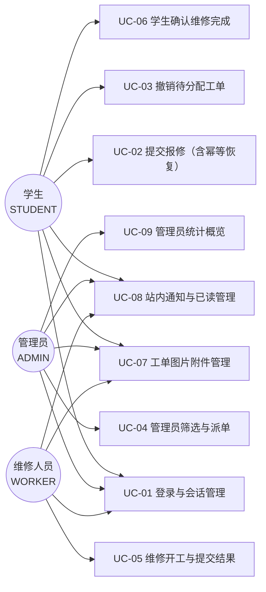

# 软件需求规格说明书（SRS）

**项目名称**：FixCampus · 校园报修管理平台  
**文档版本**：v1.0（对齐当前 Web/PWA + Flyway `V1～V6` 实现基线）  
**编制日期**：2026-11-26  
**相关文档**：[返回 README](../../README.md) · [系统概要与详细设计说明书](02-SYSTEM-AND-DATABASE-DESIGN.md) · [测试计划与测试报告](03-TEST-PLAN-AND-REPORT.md) · [用户与部署手册](04-USER-AND-DEPLOYMENT-MANUAL.md) · [开发过程与迭代记录](05-DEVELOPMENT-PROCESS-AND-ITERATION-LOG.md)

---

## 1. 引言

### 1.1 编写目的与项目背景

高校宿舍、教学楼等校园公共设施报修流程涉及学生、后勤管理员与维修人员三类角色。传统口头、电话或群聊报修方式存在报修信息不完整、派单进度不透明、维修过程难追溯、多人重复操作易冲突、完工确认缺失等痛点。

本说明书规范 **FixCampus · 校园报修管理平台** 的业务范围、角色权限、用例规约、功能需求与非功能需求，作为系统设计、编码实现、自动化测试与课程验收的统一依据。

### 1.2 系统范围与边界

| 维度 | 本阶段明确纳入 | 本阶段明确不纳入（延期或排除） |
| --- | --- | --- |
| 运行形态 | 桌面/移动浏览器 Web SPA（`/app/`）+ 最小 PWA 应用壳；保留传统 Thymeleaf SSR 兼容路径 | 原生 Windows 桌面端（Tauri 2）、原生 Android 端（Capacitor）、iOS/iPadOS 原生客户端 |
| 业务流程 | 学生报修（含图片附件与待分配撤销）→ 管理员统计与派单 → 维修人员开工、上传完工图并提交结果 → 学生收到通知并确认完成 | 工单改派、返修重开、评价打分、耗材结算、多租户隔离 |
| 认证与入口 | Spring Security 服务端 Servlet Session + CSRF + Origin 校验 + 进程内限流；演示/生产 Profile 关闭自助注册与改密 | 校园统一身份认证（CAS/SSO）、短信验证码、OAuth2 第三方登录 |
| 数据与统计 | MySQL 8.4（Flyway `V1～V6` 六表）、管理员全量状态/分类统计、7/14/30 天按日趋势与两类耗时 | 报修地点自由文本的启发式区域聚合、分布式对象存储、多节点集群部署 |
| 部署与验收 | 本机隔离 MySQL 8.4 回环演示、零 `.git` 干净目录独立构建运行、GitHub Actions 持续集成 | 公网 HTTPS 生产上线、真实校园试点运行 |

---

## 2. 干系人与角色权限矩阵

系统存在三类业务角色（对应枚举 [Role](../../src/main/java/com/fixcampus/entity/Role.java)）：

- **学生（`STUDENT`）**：故障发现者与最终验收人，仅可查看与操作本人提交的报修单。
- **管理员（`ADMIN`）**：校园后勤调度与运营负责人，可查看全量工单、查看运营统计并向有效维修人员派单。
- **维修人员（`WORKER`）**：现场维修执行人，仅可查看与处理已指派给本人的工单。

| 能力项 | 学生 (`STUDENT`) | 管理员 (`ADMIN`) | 维修人员 (`WORKER`) | 越权处理约定 |
| --- | :---: | :---: | :---: | --- |
| 登录 / 查询当前身份 / 退出 | 允许 | 允许 | 允许 | 未登录统一 `401 AUTH_REQUIRED` |
| 提交报修（含幂等键） | 允许 | 拒绝 (`403`) | 拒绝 (`403`) | 跨角色路径返回 `403 ROLE_FORBIDDEN` |
| 查看工单列表与详情 | 仅本人 | 全量 | 仅指派给本人 | 同角色越权/不存在统一返回 `404 ORDER_NOT_FOUND` |
| 撤销待分配工单 | 仅本人待分配 | 拒绝 (`403`) | 拒绝 (`403`) | 非待分配返回 `409 ORDER_CONFLICT` |
| 查看维修员候选名单与派单 | 拒绝 (`403`) | 允许 | 拒绝 (`403`) | 非有效维修员返回 `400`；非待分配返回 `409` |
| 开始维修 / 提交维修结果 | 拒绝 (`403`) | 拒绝 (`403`) | 仅本人被派工单 | 非本人返回 `404`；状态不符返回 `409` |
| 确认维修完成 | 仅本人待确认 | 拒绝 (`403`) | 拒绝 (`403`) | 仅在确认时写入 `completed_at` |
| 上传 / 删除工单图片附件 | 待分配/待维修可传（≤3张）；待分配可删本人上传 | 只读查看全量工单附件 | 维修中可传（≤2张），不可删 | 跨角色 `403`；越权/不存在 `404`；超额 `409`；超大小 `413` |
| 查看与标记站内通知已读 | 仅本人通知 | 仅本人通知 | 仅本人通知 | 访问/标记他人通知返回 `404 NOTIFICATION_NOT_FOUND` |
| 查看管理员统计概览 | 拒绝 (`403`) | 允许 | 拒绝 (`403`) | 非管理员路由与服务层双重拒绝 `403` |

---

## 3. 用例模型与核心用例规约

### 3.1 系统用例关系图

### 3.2 核心用例规约表

#### UC-01 登录与会话管理
- **参与者**：学生、管理员、维修人员
- **前置条件**：用户拥有有效预置账号；前端已通过 `GET /api/v1/auth/csrf` 获取当前会话 CSRF 令牌。
- **主成功场景**：
  1. 用户在 `/app/` 输入用户名与密码并提交。
  2. 后端规范化用户名（去首尾空格、转小写）并校验 PBKDF2 密码哈希。
  3. 认证成功后轮换 `JSESSIONID`、清除内存凭据哈希、刷新 CSRF 令牌，按服务端数据库角色返回身份并进入对应工作台。
  4. 用户点击「退出」后销毁当前会话并清除 Cookie。
- **异常与扩展分支**：
  - 凭据错误返回 `401 INVALID_CREDENTIALS`；连续高频尝试触发登录限流返回 `429 RATE_LIMITED` + `Retry-After`。
  - 已登录状态下重复调用登录接口返回 `409 AUTH_ALREADY_AUTHENTICATED`。
  - 在 `web-slice` / `demo` / `prod` Profile 下访问 `/register` 返回 `403`，禁止自助注册。
- **后置条件**：有效登录建立受 `HttpOnly` / `SameSite=Lax` 保护的服务端会话；退出后旧会话失效。

#### UC-02 学生提交报修（含幂等恢复）
- **参与者**：学生
- **前置条件**：已以 `STUDENT` 身份登录。
- **主成功场景**：
  1. 学生进入 `/app/new`，填写报修地点（1～120 码点）、选择 5 类报修分类之一、填写问题描述（1～2000 码点）。
  2. 前端生成 UUID v4 `Idempotency-Key` 并发送 `POST /api/v1/orders`。
  3. 后端在事务内创建 `PENDING_ASSIGNMENT` 工单、写入 `SUBMITTED` 事件、持久化 `idempotency_requests` 并向全部管理员写入 `ORDER_SUBMITTED` 站内通知。
  4. 返回 `201 Created`，前端跳转至工单详情页。
- **异常与扩展分支**：
  - 若网络超时/响应丢失，前端保留原表单与同一 `Idempotency-Key`，提示用户先在恢复条中点击「重新确认身份／CSRF」再手动点击「提交报修／恢复原提交」；服务端重放同键同内容时直接返回原工单，同键不同内容返回 `409`。
  - 字段为空或超长返回 `400 VALIDATION_ERROR`；触发写限流返回 `429`。
- **后置条件**：数据库持久保存工单、提交事件、幂等记录与管理员通知。

#### UC-03 学生撤销待分配工单
- **参与者**：学生
- **前置条件**：已登录，目标工单属于当前学生且状态为 `PENDING_ASSIGNMENT`。
- **主成功场景**：学生在详情页点击「撤销报修」并二次确认 → 后端加悲观行锁核对归属与状态 → 更新为 `CANCELLED`、追加 `CANCELLED` 事件、向管理员写入 `ORDER_CANCELLED` 通知 → 返回 `204 No Content`。
- **异常与扩展分支**：工单已被管理员派单或非待分配状态时返回 `409 ORDER_CONFLICT`；他人工单返回 `404 ORDER_NOT_FOUND`。
- **后置条件**：工单进入终态 `CANCELLED`，无法再派单或维修。

#### UC-04 管理员筛选与派单
- **参与者**：管理员
- **前置条件**：已以 `ADMIN` 身份登录。
- **主成功场景**：
  1. 管理员在全量工单列表按状态、关键词、排序分页检索目标待分配工单。
  2. 进入工单详情，从后端加载的有效维修员名单（`GET /api/v1/admin/workers`）中选择维修员并提交派单。
  3. 后端加行锁核对目标工单为 `PENDING_ASSIGNMENT` 且目标账号为 `WORKER`，更新为 `PENDING_REPAIR`、写入 `ASSIGNED` 事件并同事务通知学生与被派维修员，返回 `204 No Content`。
- **异常与扩展分支**：并发双派单或与学生撤销竞争时，仅先提交事务胜出，后到者返回 `409 ORDER_CONFLICT`；行锁等待超过 3 秒回滚并返回 `503 TEMPORARILY_UNAVAILABLE`。
- **后置条件**：工单归属至指定维修员，双方均收到未读通知。

#### UC-05 维修开工与提交结果
- **参与者**：维修人员
- **前置条件**：已以 `WORKER` 身份登录，工单已指派给当前维修人员。
- **主成功场景**：
  1. 维修员在「待维修」工单详情点击「开始维修」→ 行锁更新为 `IN_PROGRESS`、写入 `REPAIR_STARTED` 事件与学生通知（`204`）。
  2. 现场处理后可上传完工照片（见 UC-07），填写可选维修说明（≤1000 码点）并提交「提交维修结果」→ 更新为 `PENDING_CONFIRMATION`、写入 `REPAIR_COMPLETED` 事件与学生通知（`204`）。
- **异常与扩展分支**：访问未指派给本人的工单返回 `404 ORDER_NOT_FOUND`；跳步提交或重复操作返回 `409 ORDER_CONFLICT`。
- **后置条件**：工单处于 `PENDING_CONFIRMATION`，等待学生验收，此时 `completed_at` 保持为 `NULL`。

#### UC-06 学生确认维修完成
- **参与者**：学生
- **前置条件**：已登录，本人报修单状态为 `PENDING_CONFIRMATION`。
- **主成功场景**：学生查看维修结果与完工照片后点击「确认维修完成」→ 后端加行锁更新状态为 `COMPLETED`、写入 `completed_at`、追加 `CONFIRMED` 事件并通知负责维修员 → 返回 `204 No Content`。
- **异常与扩展分支**：重复确认返回 `409 ORDER_CONFLICT`；事务异常回滚时不显示成功提示。
- **后置条件**：工单进入终态 `COMPLETED`，刷新页面保持完整 5 节点时间线。

#### UC-07 工单图片附件管理
- **参与者**：学生（上传/预览/待分配删除）、维修人员（维修中上传/预览）、管理员（只读预览）
- **前置条件**：目标工单在当前角色可见范围内；上传文件满足 PNG/JPEG 格式且单图 ≤ 2 MiB。
- **主成功场景**：
  1. 用户选择图片提交至对应角色前缀的上传接口。
  2. 后端验证魔数（PNG/JPEG）、用 `ImageReader` 预检宽高（≤4096）与总像素（≤16M）、完整解码并剥离 EXIF 重编码。
  3. 在进程内写串行化与工单行锁内校验单工单上限（学生 ≤ 3 张 / 维修员 ≤ 2 张）及全局配额（≤ 64 MiB），生成随机 `storage_key` 落盘并写入 `order_attachments`，返回 `201 Created`。
  4. 三角色通过各自角色前缀 `/{aid}/content` 预览安全图片流；学生在待分配阶段可删除本人上传附件（`204 No Content`）。
- **异常与扩展分支**：伪造扩展名、SVG/GIF/损坏图片或超像素返回 `400 INVALID_ATTACHMENT`；超单图大小返回 `413 PAYLOAD_TOO_LARGE`；超张数返回 `409 ATTACHMENT_LIMIT_EXCEEDED`；超全局配额返回 `409 ATTACHMENT_QUOTA_EXCEEDED`；跨角色访问返回 `403`，越权或不存在返回 `404`。
- **后置条件**：图片元数据与净化后磁盘文件一致；事务回滚或删除后通过回调清理磁盘文件（失败项入队补偿）。

#### UC-08 站内通知与已读管理
- **参与者**：学生、管理员、维修人员
- **前置条件**：已登录；任一工单状态写操作触发了对应接收人通知。
- **主成功场景**：
  1. 前端导航栏展示未读角标，在页面可见且联网时每 30 秒轮询 `GET /api/v1/notifications/unread-count`。
  2. 用户进入 `/app/notifications` 查看分页通知（支持仅看未读筛选），可点击单条「标为已读」（`POST /api/v1/notifications/{id}/read`）或顶部「全部标为已读」（`POST /api/v1/notifications/read-all`），并点击工单编号跳转至对应工单详情。
- **异常与扩展分支**：重复标记已读保持幂等且保留原 `readAt`；尝试标记他人或不存在的通知返回 `404 NOTIFICATION_NOT_FOUND`；页面切换标签或断网时自动暂停轮询。
- **后置条件**：未读角标与服务端 `read_at` 状态一致。

#### UC-09 管理员统计概览
- **参与者**：管理员
- **前置条件**：已以 `ADMIN` 身份登录。
- **主成功场景**：管理员进入 `/app/stats`，默认查询近 14 天（可切换 7 / 14 / 30 天）→ 后端在只读事务内执行 SQL 聚合返回全量状态分布、报修分类分布、按日趋势及两类耗时指标（同时在 API 契约中声明自由文本地点暂不做区域聚合）→ 页面渲染卡片、占比条、趋势图与可访问明细表。
- **异常与扩展分支**：非法 `days` 参数返回 `400 VALIDATION_ERROR`；非管理员直接访问统计 API 返回 `403 ROLE_FORBIDDEN`（前端工作区导航隐藏入口并拦截 `/app/stats` 路由）；有效样本为 0 时均值/最小/最大返回 `null` 并展示「暂无有效样本」。
- **后置条件**：只读查询不产生任何数据副作用。

---

## 4. 功能需求编号矩阵

| 编号 | 需求模块 | 需求摘要 | 关联用例 |
| --- | --- | --- | --- |
| `FR-01` | 认证会话 | 服务端 Servlet Session 登录/退出、登录轮换 Session ID、PBKDF2 密码哈希、CSRF 与同源 Origin 校验 | UC-01 |
| `FR-02` | 入口加固 | Web/演示/生产 Profile 下根路径 `/` 重定向 `/app/`、关闭自助注册、禁止改密、隔离 Mock 与生产构建 | UC-01 |
| `FR-03` | 限流保护 | 鉴权后对登录接口及显式业务写路由执行进程内限流，超限返回 `429` + `Retry-After` + `X-Request-Id` | UC-01～08 |
| `FR-04` | 报修提交 | 学生提交地点/分类/描述（按 Unicode 码点校验长度并规范化换行），服务端生成状态与时间 | UC-02 |
| `FR-05` | 持久化幂等 | 创建报修支持 `Idempotency-Key` 持久化去重、并发同键回滚回查及前端未知结果手动恢复 | UC-02 |
| `FR-06` | 工单撤销 | 学生仅可撤销本人 `PENDING_ASSIGNMENT` 工单并记录 `CANCELLED` 事件 | UC-03 |
| `FR-07` | 列表分页筛选 | 三角色按身份范围执行数据库分页、状态筛选、关键词检索（安全处理 LIKE 元字符）与双向排序 | UC-04 |
| `FR-08` | 管理员派单 | 管理员查询有效 `WORKER` 列表并派单，状态转为 `PENDING_REPAIR` 并记录 `ASSIGNED` 事件 | UC-04 |
| `FR-09` | 维修执行 | 被指派维修员执行「开始维修」与「提交维修结果」，保存可选维修说明并记录对应事件 | UC-05 |
| `FR-10` | 学生确认 | 学生对本人 `PENDING_CONFIRMATION` 工单确认完成，写入 `completed_at` 与 `CONFIRMED` 事件 | UC-06 |
| `FR-11` | 处理时间线 | 按工单记录并展示全流程 `order_events`（含操作人角色/姓名快照），对缺失历史事件如实显示不补造 | UC-02～06 |
| `FR-12` | 图片校验净化 | 纯 JDK `ImageIO` 校验 PNG/JPEG 魔数、解码前尺寸/像素预检与剥离 EXIF 重编码 | UC-07 |
| `FR-13` | 附件配额与清理 | 进程内写串行化 + 行锁校验单工单上限与 64 MiB 全局配额；事务回调清理磁盘文件并对失败项入队补偿 | UC-07 |
| `FR-14` | 附件三角色访问 | 按角色前缀隔离权限（跨角色 `403` / 越权 `404`），安全响应头输出图片流，学生待分配可删本人上传 | UC-07 |
| `FR-15` | 同事务通知 | 工单 6 类写操作在 `@Transactional(MANDATORY)` 同事务内按确定性幂等键写入 `notifications` | UC-08 |
| `FR-16` | 通知查询与已读 | 接收人隔离的分页列表、仅看未读筛选、30 秒可见/联网轮询、单条与全部幂等已读 | UC-08 |
| `FR-17` | 管理员统计 | 全量状态与分类分布、7/14/30 天按日趋势、两类独立耗时（微秒精度、空样本 `null`、披露缺失事件） | UC-09 |
| `FR-18` | 演示库重置 | 双重显式开关（Fail-Closed）控制的数据库单事务重置示例数据与提交后清理托管附件 | 运维/演示 |
| `FR-19` | 最小 PWA | 提供 `manifest.webmanifest`、图标与仅缓存构建静态应用壳的 Service Worker（绝不缓存 `/api/v1`） | 全局 Web |
| `FR-20` | 传统 SSR 兼容 | 保留默认 Profile 下的 Thymeleaf SSR 路径，不因新增通知表破坏旧三表运行方式 | 兼容路径 |

---

## 5. 非功能需求指标（NFR）

| 类别 | 编号 | 指标与约束要求 |
| --- | --- | --- |
| 安全性 | `NFR-SEC-01` | 密码使用 PBKDF2 哈希，日志与错误体绝不输出密码、原始 SQL、堆叠或私人凭据 |
| 安全性 | `NFR-SEC-02` | 所有业务读/写接口强制 `Cache-Control: no-store`（图片流 `private, no-store` + `nosniff` + `sandbox` CSP） |
| 安全性 | `NFR-SEC-03` | 严格区分认证失败（`401`）、角色越权（`403`）与对象不可见（`404`），防止越权探测他人工单/附件/通知 |
| 并发一致性 | `NFR-CON-01` | 所有状态变更通过 `PESSIMISTIC_WRITE` 行锁串行化；会话级 `innodb_lock_wait_timeout = 3`，锁超时完整回滚返回 `503` |
| 并发一致性 | `NFR-CON-02` | 数据库层通过外键、`CHECK` 约束、事件 `(order_id, action)` 唯一键与通知 `idempotency_key` 唯一键兜底 |
| 性能 | `NFR-PERF-01` | 列表与统计均在 MySQL 侧完成分页与 SQL 聚合，禁止拉取全表实体到内存；10 万条工单管理员末页经延迟关联优化 P95 ≤ 50 ms（单机基准实测 39.88 ms，见 [性能基准](../benchmark.md)） |
| 可观测性 | `NFR-OBS-01` | 全链路生成/校验并透传 `X-Request-Id` 响应头、错误正文 `requestId` 字段与脱敏 MDC 日志，前端支持一键复制 |
| 可用性与兼容 | `NFR-UX-01` | 支持桌面与移动端响应式布局、200% 浏览器缩放及键盘焦点可访问操作；前端静态检查禁止任何直连外网请求 |
| 可维护性 | `NFR-MNT-01` | 零新增重型第三方框架；Flyway `V1～V6` 严格增量迁移且禁用 `clean` 与 `ddl-auto=update`，拒绝接管非空未受管库 |
