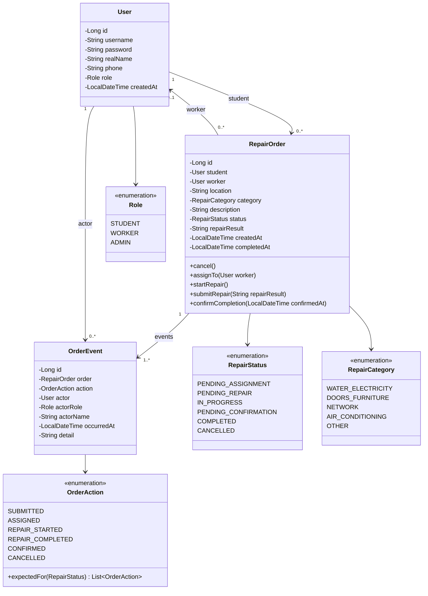
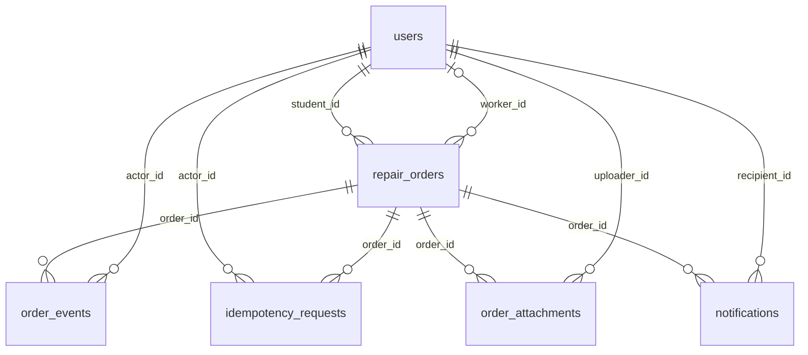

# 系统概要与详细设计说明书

**项目名称**：FixCampus · 校园报修管理平台  
**文档版本**：v1.0（对齐当前 Web/PWA + Flyway `V1～V6` 实现基线）  
**编制日期**：2026-11-26  
**相关文档**：[返回 README](../../README.md) · [软件需求规格说明书](01-REQUIREMENTS-SPECIFICATION.md) · [测试计划与测试报告](03-TEST-PLAN-AND-REPORT.md) · [系统架构图](../portfolio/SYSTEM-DIAGRAMS.md) · [技术架构说明](../technical/ARCHITECTURE.md)

---

## 1. 总体架构与模块划分

### 1.1 分层单体架构

系统采用**前后端同源协作的分层单体架构**：前端基于 React 19 + TypeScript + Vite 构建 SPA（挂载于 `/app/`）并附带最小 PWA 应用壳；后端基于 Java 25 + Spring Boot 3.5 + Spring Security + Spring Data JPA / JDBC，底层使用 MySQL 8.4（InnoDB）与本地托管附件目录。

- **前端目录划分（`frontend/src/`）**：
  - `app/`：应用路由外壳（`App.tsx`、`layouts/AppShell.tsx`）、PWA 更新/离线状态提示（`PwaStatus.tsx`）、演示模式配置（`demoConfig.ts`）、Mock 隔离入口。
  - `pages/`：真实工作台容器（`RealStudentApp.tsx`）、工单列表/创建/详情操作（`RealOrderWorkspace.tsx`）、图片附件面板（`RealOrderAttachments.tsx`）、站内通知页（`RealNotifications.tsx`）、管理员统计页（`RealAdminStats.tsx`）、统一错误提示（`RealErrorNotice.tsx`）。
  - `shared/`：TypeScript 协议契约（`api/contracts.ts`）、统一同源 REST 客户端（`api/rest/studentClient.ts`）、Zod 表单校验（`forms/schemas.ts`）、设计令牌与基础组件（`components/`、`design-tokens/`）。
- **后端分包划分（`src/main/java/com/fixcampus/`）**：
  - `api/v1/`：REST 控制器（`StudentApi`、`OrderOperationsApi`、`AdminStatisticsApi`、`OrderAttachmentsApi`、`NotificationsApi`）、安全过滤链与限流/请求号（`ApiSecurityConfig`、`ApiRateLimitFilter`、`ApiRequestIdFilter`）、统一错误映射（`ApiErrors`、`ApiProblem`、`ApiRoutingErrors`）以及 JDBC 分页/附件编排（`StudentOrders`、`OperationalOrders`、`OrderAttachments`）。
  - `service/`：核心业务与领域服务（`RepairOrderService`、`UserService`、`AdminStatisticsService`、`NotificationService`、`AttachmentImages`、`AttachmentStorage`、`DemoAccountService`、`DemoResetService`）。
  - `repository/`：Spring Data JPA 数据访问与行锁接口（`RepairOrderRepository`、`OrderEventRepository`、`UserRepository`）及 JDBC 附件仓储类（`OrderAttachmentRepository`）。
  - `entity/`：领域实体与枚举（`User`、`RepairOrder`、`OrderEvent`、`Role`、`RepairStatus`、`RepairCategory`、`OrderAction`）。
  - `config/` & `security/`：隔离迁移校验（`IsolatedMigrationConfig`）、附件配置（`AttachmentProperties`）、演示初始化与调度（`DemoDataInitializer`、`DemoResetScheduler`）、认证会话生命周期（`SecurityConfig`、`CampusUserDetailsService`、`SessionLifecycle`）。
  - `controller/`：向后兼容的传统 Thymeleaf SSR 控制器。

---

## 2. 核心领域模型与状态机设计

### 2.1 核心领域类图

注：`idempotency_requests`、`order_attachments` 与 `notifications` 在后端主要通过 JDBC / 专用仓储与服务直接操作，避免在实体层引入冗余延迟加载关联（`spring.jpa.open-in-view=false`）。

### 2.2 工单单向六状态机

状态转移仅允许通过 `RepairOrderService` 在 `@Transactional` 事务内执行 `PESSIMISTIC_WRITE` 行锁后推进：

| 当前状态 | 允许动作 | 触发角色 | 目标状态 | 写入事件 (`OrderAction`) | 同步写入通知接收人 |
| --- | --- | --- | --- | --- | --- |
| （新建） | 提交报修 | `STUDENT` | `PENDING_ASSIGNMENT` | `SUBMITTED` | 全部 `ADMIN` |
| `PENDING_ASSIGNMENT` | 撤销工单 | `STUDENT`（本人） | `CANCELLED`（终态） | `CANCELLED` | 全部 `ADMIN` |
| `PENDING_ASSIGNMENT` | 派单 | `ADMIN` | `PENDING_REPAIR` | `ASSIGNED` | 报修学生 + 被派维修员 |
| `PENDING_REPAIR` | 开始维修 | `WORKER`（被派） | `IN_PROGRESS` | `REPAIR_STARTED` | 报修学生 |
| `IN_PROGRESS` | 提交维修结果 | `WORKER`（被派） | `PENDING_CONFIRMATION` | `REPAIR_COMPLETED` | 报修学生 |
| `PENDING_CONFIRMATION` | 确认维修完成 | `STUDENT`（本人） | `COMPLETED`（终态，写 `completed_at`） | `CONFIRMED` | 负责维修员 |

---

## 3. 数据库详细设计（Flyway `V1～V6`）

所有表采用 `ENGINE=InnoDB DEFAULT CHARSET=utf8mb4 COLLATE=utf8mb4_0900_ai_ci`，时间精度统一为 `DATETIME(6)`（连接时区 `Asia/Hong_Kong`）。`web-slice` / `demo` / `prod` 禁用 `ddl-auto=update`（固定为 `validate`），由 Flyway 按 `V1` → `V6` 顺序执行增量迁移。

### 3.1 六表 ER 关系图

### 3.2 逐表数据字典

#### 表 1：`users`（[V1__create_users.sql](../../src/main/resources/db/migration/V1__create_users.sql)）

| 列名 | 数据类型与字符集 | 可空 | 约束与说明 |
| --- | --- | :---: | --- |
| `id` | `BIGINT AUTO_INCREMENT` | NO | 主键 (`PRIMARY KEY`) |
| `username` | `VARCHAR(30)` (`ascii / ascii_bin`) | NO | 唯一 (`uk_users_username`)；`CHECK` 限定小写且长度 4～30 |
| `password` | `VARCHAR(255)` | NO | PBKDF2 算法标识 + 密码哈希 |
| `real_name` | `VARCHAR(50)` | NO | 展示姓名；`CHECK` 要求去空格后长度 ≥ 1 |
| `phone` | `VARCHAR(30)` | YES | 可选联系方式 |
| `role` | `VARCHAR(16)` | NO | `CHECK (role IN ('STUDENT', 'WORKER', 'ADMIN'))` |
| `created_at` | `DATETIME(6)` | NO | 创建时间 |

#### 表 2：`repair_orders`（[V2__create_repair_orders.sql](../../src/main/resources/db/migration/V2__create_repair_orders.sql)）

| 列名 | 数据类型 | 可空 | 约束与说明 |
| --- | --- | :---: | --- |
| `id` | `BIGINT AUTO_INCREMENT` | NO | 主键 |
| `student_id` | `BIGINT` | NO | 外键 `fk_orders_student -> users(id)` (`ON DELETE RESTRICT ON UPDATE RESTRICT`) |
| `worker_id` | `BIGINT` | YES | 外键 `fk_orders_worker -> users(id)` (`ON DELETE RESTRICT ON UPDATE RESTRICT`)；受 `ck_orders_worker_state` 约束 |
| `location` | `VARCHAR(120)` | NO | 自由文本报修地点；`CHECK` 去空格非空 |
| `category` | `VARCHAR(32)` | NO | `CHECK` 5 种分类枚举值 |
| `description` | `VARCHAR(2000)` | NO | 故障描述；`CHECK` 去空格非空 |
| `status` | `VARCHAR(32)` | NO | `CHECK` 6 种工单状态枚举值 |
| `repair_result` | `VARCHAR(1000)` | YES | 维修人员填写的维修说明 |
| `created_at` | `DATETIME(6)` | NO | 创建时间 |
| `completed_at` | `DATETIME(6)` | YES | 学生确认完成时间；`ck_orders_completed` 强制仅 `COMPLETED` 非空，`ck_orders_time` 强制 `>= created_at` |

- **索引**：`idx_orders_student_created (student_id, created_at DESC, id DESC)`、`idx_orders_worker_created (worker_id, created_at DESC, id DESC)`、`idx_orders_status_created (status, created_at DESC, id DESC)`、`idx_orders_created (created_at DESC, id DESC)`。

#### 表 3：`order_events`（[V3__create_order_events.sql](../../src/main/resources/db/migration/V3__create_order_events.sql)）

| 列名 | 数据类型 | 可空 | 约束与说明 |
| --- | --- | :---: | --- |
| `id` | `BIGINT AUTO_INCREMENT` | NO | 主键 |
| `order_id` | `BIGINT` | NO | 外键 `fk_events_order -> repair_orders(id)` (`ON DELETE CASCADE ON UPDATE RESTRICT`) |
| `action` | `VARCHAR(32)` | NO | 与 `order_id` 构成唯一键 `uk_events_order_action (order_id, action)`；与 `actor_role` 共同受 `ck_events_action_role` 校验 |
| `actor_id` | `BIGINT` | NO | 外键 `fk_events_actor -> users(id)` (`ON DELETE RESTRICT ON UPDATE RESTRICT`) |
| `actor_role` | `VARCHAR(16)` | NO | 操作时角色快照 |
| `actor_name` | `VARCHAR(50)` | NO | 操作时姓名快照；`CHECK` 去空格非空 |
| `occurred_at` | `DATETIME(6)` | NO | 事件发生微秒时间戳 |
| `detail` | `VARCHAR(1000)` | YES | 可选补充说明（如维修结果） |

- **索引**：`idx_events_order_id (order_id, id)`。

#### 表 4：`idempotency_requests`（[V4__create_idempotency.sql](../../src/main/resources/db/migration/V4__create_idempotency.sql)）

| 列名 | 数据类型与字符集 | 可空 | 约束与说明 |
| --- | --- | :---: | --- |
| `id` | `BIGINT AUTO_INCREMENT` | NO | 主键 |
| `actor_id` | `BIGINT` | NO | 外键 `fk_idempotency_actor -> users(id)` (`ON DELETE RESTRICT`) |
| `operation_code` | `VARCHAR(64)` (`ascii / ascii_bin`) | NO | 操作类型编码 |
| `request_key` | `VARCHAR(64)` (`ascii / ascii_bin`) | NO | 客户端幂等键；构成唯一键 `uk_idempotency_actor_operation_key (actor_id, operation_code, request_key)` |
| `payload_hash` | `BINARY(32)` | NO | 规范化请求内容 SHA-256 摘要（识别同键不同内容返回 `409`） |
| `order_id` | `BIGINT` | NO | 外键 `fk_idempotency_order -> repair_orders(id)` (`ON DELETE RESTRICT`) |
| `created_at` | `DATETIME(6)` | NO | 创建时间 |

#### 表 5：`order_attachments`（[V5__create_order_attachments.sql](../../src/main/resources/db/migration/V5__create_order_attachments.sql)）

| 列名 | 数据类型与字符集 | 可空 | 约束与说明 |
| --- | --- | :---: | --- |
| `id` | `BIGINT AUTO_INCREMENT` | NO | 主键 |
| `order_id` | `BIGINT` | NO | 外键 `fk_order_attachments_order -> repair_orders(id)` (`ON DELETE RESTRICT`) |
| `uploader_id` | `BIGINT` | NO | 外键 `fk_order_attachments_uploader -> users(id)` (`ON DELETE RESTRICT`) |
| `uploader_role` | `VARCHAR(16)` | NO | 上传角色（`STUDENT` / `WORKER`） |
| `original_filename` | `VARCHAR(120)` | NO | 净化截断后的展示名（绝不用于磁盘路径） |
| `content_type` | `VARCHAR(32)` (`ascii / ascii_bin`) | NO | 服务端检测后的真实 MIME（`image/png` / `image/jpeg`） |
| `size_bytes` | `BIGINT` | NO | 重编码后实际落盘字节数 |
| `width` / `height` | `INT` | NO | 校验后的像素宽/高 |
| `sha256` | `CHAR(64)` (`ascii / ascii_bin`) | NO | 落盘文件 SHA-256 小写十六进制摘要 |
| `storage_key` | `VARCHAR(64)` (`ascii / ascii_bin`) | NO | 唯一键 `uk_order_attachments_storage_key`（32 位随机十六进制 + 扩展名） |
| `created_at` | `DATETIME(6)` | NO | 上传时间 |

- **索引**：`idx_order_attachments_order_created (order_id, created_at, id)`、`idx_order_attachments_order_role (order_id, uploader_role)`。

#### 表 6：`notifications`（[V6__create_notifications.sql](../../src/main/resources/db/migration/V6__create_notifications.sql)）

| 列名 | 数据类型与字符集 | 可空 | 约束与说明 |
| --- | --- | :---: | --- |
| `id` | `BIGINT AUTO_INCREMENT` | NO | 主键 |
| `recipient_id` | `BIGINT` | NO | 外键 `fk_notifications_recipient -> users(id)` (`ON DELETE RESTRICT ON UPDATE RESTRICT`) |
| `order_id` | `BIGINT` | NO | 外键 `fk_notifications_order -> repair_orders(id)` (`ON DELETE RESTRICT ON UPDATE RESTRICT`) |
| `event_type` | `VARCHAR(32)` (`ascii / ascii_bin`) | NO | `ck_notifications_event_type` 校验 6 类事件白名单且拒绝前后空格 |
| `title` | `VARCHAR(100)` | NO | 通知标题 |
| `body` | `VARCHAR(255)` | NO | 通知正文（按码点安全截断，不含凭据/联系方式） |
| `idempotency_key` | `VARCHAR(96)` (`ascii / ascii_bin`) | NO | 唯一键 `uk_notifications_idempotency_key`（格式 `order:{orderId}:{eventType}:recipient:{recipientId}`） |
| `read_at` | `DATETIME(6)` | YES | 已读时间（`NULL` 为未读） |
| `created_at` | `DATETIME(6)` | NO | 创建时间 |

- **索引**：`idx_notifications_recipient_created (recipient_id, created_at, id)`、`idx_notifications_recipient_unread (recipient_id, read_at, id)`、`idx_notifications_order (order_id)`。

---

## 4. REST API 详细接口规范（`/api/v1`）

所有 `/api/v1/**` 响应均透传 `X-Request-Id` 与 `Cache-Control: no-store`（图片内容为 `private, no-store`）；所有写请求须校验同源 `Origin` 与当前会话 CSRF 令牌。

### 4.1 端点清单

| 模块 | 方法与路径 | 允许角色 | 关键请求参数 / 头 | 成功状态与返回 |
| --- | --- | --- | --- | --- |
| 认证 | `GET /api/v1/auth/csrf` | 公开 | 无 | `200` `{headerName, token}` |
| 认证 | `POST /api/v1/auth/login` | 公开（限流） | JSON `{username, password}` + CSRF + Origin | `200` `{id, username, displayName, role}` |
| 认证 | `GET /api/v1/me` | 已认证 | Cookie | `200` 当前身份信息 |
| 认证 | `POST /api/v1/auth/logout` | 已认证 | CSRF + Origin（不限流） | `204 No Content` |
| 学生 | `GET /api/v1/orders` | `STUDENT` | `page`, `size`, `sort`, `status`, `q` | `200` 分页列表（仅本人） |
| 学生 | `GET /api/v1/orders/{id}` | `STUDENT` | 路径 `id` | `200` 详情 + 时间线（仅本人） |
| 学生 | `POST /api/v1/orders` | `STUDENT`（限流） | `Idempotency-Key` (UUID v4) + `{location, category, description}` | `201 Created` + `Location` |
| 管理员 | `GET /api/v1/admin/orders` | `ADMIN` | `page`, `size`, `sort`, `status`, `q` | `200` 全量分页列表 |
| 管理员 | `GET /api/v1/admin/orders/{id}` | `ADMIN` | 路径 `id` | `200` 工单详情 |
| 管理员 | `GET /api/v1/admin/workers` | `ADMIN` | 无 | `200` 有效维修员精简清单 |
| 管理员 | `GET /api/v1/admin/statistics` | `ADMIN` | `days` (`7` / `14` / `30`，默认 `14`) | `200` 状态/分类/趋势/两类耗时/区域说明 |
| 维修员 | `GET /api/v1/worker/orders` | `WORKER` | `page`, `size`, `sort`, `status`, `q` | `200` 已指派工单分页列表 |
| 维修员 | `GET /api/v1/worker/orders/{id}` | `WORKER` | 路径 `id` | `200` 已指派工单详情 |
| 流转 | `POST /api/v1/orders/{id}/assign` | `ADMIN`（限流） | `{workerId}` | `204 No Content` |
| 流转 | `POST /api/v1/orders/{id}/start` | `WORKER`（限流） | `{}` | `204 No Content` |
| 流转 | `POST /api/v1/orders/{id}/complete` | `WORKER`（限流） | `{repairResult?}` | `204 No Content` |
| 流转 | `POST /api/v1/orders/{id}/confirm` | `STUDENT`（限流） | `{}` | `204 No Content` |
| 流转 | `POST /api/v1/orders/{id}/cancel` | `STUDENT`（限流） | `{}` | `204 No Content` |
| 附件 | `GET /api/v1/{orders\|worker/orders\|admin/orders}/{id}/attachments` | 对应角色 | 路径 `id` | `200` `{orderId, items, limits, canUpload}` |
| 附件 | `POST /api/v1/{orders\|worker/orders}/{id}/attachments` | `STUDENT` / `WORKER`（限流） | `multipart/form-data` 字段 `file` | `201 Created` `OrderAttachmentItem` |
| 附件 | `GET /api/v1/{orders\|worker/orders\|admin/orders}/{id}/attachments/{aid}/content` | 对应角色 | 路径 `id`, `aid` | `200` 二进制图片流（安全响应头） |
| 附件 | `DELETE /api/v1/orders/{id}/attachments/{aid}` | `STUDENT`（限流） | 路径 `id`, `aid`（仅待分配且本人上传） | `204 No Content` |
| 通知 | `GET /api/v1/notifications` | 已认证 | `page` (≥0), `size` (1..50), `unreadOnly` | `200` 分页列表 + 全局 `unreadCount` |
| 通知 | `GET /api/v1/notifications/unread-count` | 已认证 | 无 | `200` `{unreadCount}` |
| 通知 | `POST /api/v1/notifications/{id}/read` | 已认证（限流） | 空体或 `{}`（拒绝尾随 JSON） | `200` `{id, read, readAt, unreadCount}` |
| 通知 | `POST /api/v1/notifications/read-all` | 已认证（限流） | 空体或 `{}`（拒绝尾随 JSON） | `200` `{markedCount, unreadCount}` |

### 4.2 统一错误响应契约（`application/problem+json`）

所有错误均以 RFC 7807 风格返回 `{type, title, status, code, message, requestId}`（由 [ApiProblem](../../src/main/java/com/fixcampus/api/v1/ApiProblem.java) 与 [ApiErrors](../../src/main/java/com/fixcampus/api/v1/ApiErrors.java) 统一输出）：

| HTTP 状态 | 典型 `code` | 触发场景 |
| :---: | --- | --- |
| `400` | `VALIDATION_ERROR` / `INVALID_QUERY` / `INVALID_WORKER` / `INVALID_ATTACHMENT` | 参数越界、非法查询条件、无效维修员、非法 JSON/尾随片段、伪造或超像素图片 |
| `401` | `AUTH_REQUIRED` / `INVALID_CREDENTIALS` | 未登录、会话过期或账号密码错误 |
| `403` | `ROLE_FORBIDDEN` / `CSRF_REJECTED` / `ORIGIN_REJECTED` | 跨角色路由访问、CSRF 或 Origin 校验失败 |
| `404` | `ORDER_NOT_FOUND` / `ATTACHMENT_NOT_FOUND` / `NOTIFICATION_NOT_FOUND` | 对象不存在或同角色越权访问他人资源 |
| `405` / `415` | `VALIDATION_ERROR` | 不支持的 HTTP 方法或不支持的请求媒体类型 |
| `409` | `ORDER_CONFLICT` / `IDEMPOTENCY_KEY_REUSED` / `AUTH_ALREADY_AUTHENTICATED` / `ATTACHMENT_LIMIT_EXCEEDED` / `ATTACHMENT_QUOTA_EXCEEDED` | 非法状态转移、同幂等键不同内容重放、已登录重复登录、附件张数或全局配额已满 |
| `413` | `PAYLOAD_TOO_LARGE` | 上传文件超过 2 MiB 或 Spring multipart 上限 |
| `429` | `RATE_LIMITED` | 触发登录或业务写接口限流（附 `Retry-After`） |
| `503` | `TEMPORARILY_UNAVAILABLE` | 3 秒 InnoDB 行锁等待超时、数据库或存储暂不可用 |

---

## 5. 关键详细设计机制

1. **安全过滤链顺序**：`ApiRequestIdFilter` 生成并写入 MDC `requestId` → `ApiSecurityConfig` 校验同源 `Origin`、Session 认证、CSRF 与角色授权 → `ApiRateLimitFilter` 在授权之后按来源地址（登录）或会话（显式业务写路由）执行固定时间窗口限流。
2. **创建幂等与冲突恢复**：`StudentOrders.create` 先查询 `(actor_id, operation_code, request_key)`；若未命中则在单事务内插入工单、`SUBMITTED` 事件、`idempotency_requests` 与管理员通知；并发同键触发唯一键冲突时回滚写事务再回查已提交记录，摘要一致则返回原工单、不一致则返回 `409`。
3. **无依赖图片安全净化与存储绑定**：`AttachmentImages` 校验魔数并用 `ImageReader` 预检尺寸防解压炸弹，重编码剥离 EXIF；`AttachmentStorage` 通过目录内数据库绑定标记防止多库串写，用进程内公平重入锁（`ReentrantLock`）与工单行锁共同保障单工单张数与 64 MiB 配额，磁盘清理挂载事务提交/回滚回调并对删除失败键入队重试（上限 256 条）。
4. **同事务幂等通知与传统 SSR 隔离**：`NotificationService` 标注 `@Profile({"web-slice", "demo", "prod"})` 与 `@Transactional(propagation = Propagation.MANDATORY)`，通过 `INSERT ... ON DUPLICATE KEY UPDATE id = id` 静默去重同时保留外键与 `CHECK` 严格报错；`RepairOrderService` 通过 `ObjectProvider<NotificationService>` 可选注入，保证传统三表 SSR 路径零影响。
5. **10 万条工单深分页优化**：将直接 `LIMIT offset, size` 改为先按覆盖索引定位该页主键 ID 列表、再按主键回表详情，消除深偏移量全行排序搬运（详细对比见 [性能基准](../benchmark.md)）。
6. **PWA 缓存边界**：`frontend/pwa/worker.js` 仅缓存构建期静态清单资源，对 `/api/v1/**` 始终透传网络，避免跨账号或登出后从本地缓存读出旧用户业务数据。
