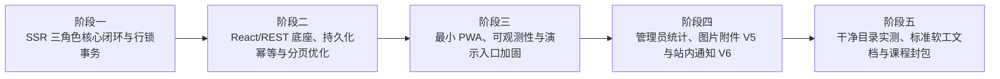

# 软件开发过程、迭代记录与项目总结

**项目名称**：FixCampus · 校园报修管理平台  
**文档版本**：v1.0（对齐当前 Web/PWA + Flyway `V1～V6` 实现基线）  
**编制日期**：2026-11-26  
**相关文档**：[返回 README](../../README.md) · [软件需求规格说明书](01-REQUIREMENTS-SPECIFICATION.md) · [系统概要与详细设计说明书](02-SYSTEM-AND-DATABASE-DESIGN.md) · [测试计划与测试报告](03-TEST-PLAN-AND-REPORT.md) · [工程设计说明](../portfolio/ENGINEERING-STORY.md)

---

## 1. 开发过程模型与工程治理

本项目采用**增量迭代开发 + 契约先行 + 自动化质量门禁**的软件工程实践，不追求“一次性堆砌大而全的技术栈”，而是围绕可验证的纵向业务闭环分阶段交付：

1. **契约先行（Contract-First）**：每个增量功能包（演示加固、管理员统计、图片附件、站内通知）在编码前先锁定数据库迁移 DDL、REST API 路径、权限矩阵与错误码契约，确保前后端并行实现时接口零歧义。
2. **分支隔离与线性历史**：所有开发从受保护的主干基线派生独立任务分支，单包聚焦验收范围，完成本地检查、代码审查与持续集成后再合并主干。
3. **持续集成与真实数据库回归**：每次变更通过 GitHub Actions 在独立 Ubuntu 24.04 环境中自动执行后端 JDK 25 + MySQL 8.4.11 全量 `clean verify`（校验 Surefire 测试与 JaCoCo 覆盖率结构化产物）以及前端 `npm run check`（类型、Lint、格式、单测、禁外网与构建）。
4. **独立只读代码审查与安全扫描**：每轮交付前执行静态敏感信息扫描、清洁源码导出审计（检查私有引用、个人路径、PNG 元数据与 Markdown 相对链接）以及独立只读审查，发现的阻断缺陷与边界问题均在合并前闭环并补齐回归测试。

---

## 2. 工作分解结构（WBS）与迭代交付记录

| 迭代阶段 | 核心交付成果 | 关键验证里程碑 |
| --- | --- | --- |
| 阶段一：传统 SSR 业务基线 | `users`、`repair_orders`、`order_events` 三表模型；Spring Security Session/CSRF；六状态机、`PESSIMISTIC_WRITE` 悲观行锁与完整处理时间线 | 真实 MySQL 并发派单/撤销/锁超时与事务回滚集成测试落地 |
| 阶段二：Web/REST 与底座升级 | 引入 React 19 / TypeScript / Vite 工作台与同源 `/api/v1`；Flyway `V1～V4` 隔离迁移；`Idempotency-Key` 持久化创建幂等；`X-Request-Id` 与脱敏日志；10 万条工单深分页延迟关联优化 | 6 线程同键幂等集成测试通过；深分页 P95 由 123.02 ms 降至 39.88 ms |
| 阶段三：PWA 与演示安全加固 | 仅缓存静态应用壳的最小 PWA；根路径 `/` 重定向 `/app/`；隔离 Mock 与生产/演示构建；禁用注册/改密；进程内登录与业务写限流（`429`）；会话锁等待超时 3 秒（`503`）；双重开关控制的演示库重置服务 | 真实浏览器三角色闭环与限流/重置/锁超时测试全绿 |
| 阶段四：三大业务能力增强 | ① 管理员统计接口与 `/app/stats` 面板（状态/分类/趋势/两类独立耗时）；② Flyway `V5` 工单图片附件（纯 JDK `ImageIO` 去 EXIF 与配额）；③ Flyway `V6` 同事务幂等站内通知与 30 秒轮询 | 后端全量测试扩展至 457 项（含 `V1～V5 → V6` 升级），前端扩展至 146 项，零新增重型依赖 |
| 阶段五：界面统一、清洁封包与标准文档 | 统一 M4.1 工作台视觉体系与会话恢复/跨标签隔离加固；同步对外文档、采集新版脱敏 Web 截图、在零 `.git` 干净目录实测前后端构建与空库 `V1～V6` 启动，补齐标准软件工程文档套件（需求/设计/测试/手册/过程） | 前端全量测试扩展至 160 项，导出安全回归全绿，干净目录实机启动与三角色验收通过 |

---

## 3. 主要工程风险与化解复盘

| 风险项 | 触发根因 | 采取的工程对策 | 复盘结论 |
| --- | --- | --- | --- |
| 并发状态写覆盖与长锁拖垮连接池 | 多角色并发操作同一工单，默认 50 秒 InnoDB 锁等待易耗尽小连接池 | 写前 `PESSIMISTIC_WRITE` 行锁 + 连接初始化设置 `innodb_lock_wait_timeout = 3`，区分 `409` 业务冲突与 `503` 锁超时回滚 | 必须用真实 MySQL 实测会话变量与超时回滚，不能只靠 Mock 假设 |
| 网络响应丢失引发重复建单 | 创建请求服务端已提交但客户端未收到响应，盲目重试会产生重复工单 | 引入 `idempotency_requests` 唯一键 `(actor_id, operation_code, request_key)` + 请求摘要比对，前端保留原键由用户显式恢复 | 幂等恢复须同时覆盖数据库并发冲突回滚回查与前端状态保留 |
| 10 万级工单深分页性能退化 | 传统 `LIMIT offset, size` 在大偏移量下需扫描并回表大量无效行 | 改为按索引先取目标页主键 ID，再按主键关联详情，保持页码与总数契约不变 | 优化前先建立可复现基准与同条件对照，避免盲目调优 |
| 图片上传解压炸弹、EXIF 隐私与悬挂文件 | 仅校验扩展名或 `Content-Type` 易被伪造，事务回滚易遗留磁盘孤儿文件 | 纯 JDK `ImageIO` 校验魔数、解码前 `ImageReader` 尺寸/像素预检、重编码剥离 EXIF、进程内写串行化 + 事务回调清理与补偿队列 | 零外部图像处理依赖也能实现完整的纵深防御 |
| 新增表破坏传统 SSR 兼容 | 默认 Profile 未启用 Flyway 且仅建旧三表，直接写通知表会导致旧路径回滚 | `NotificationService` 绑定 `web-slice`/`demo`/`prod` Profile，`RepairOrderService` 采用 `ObjectProvider` 可选注入并单测覆盖 | 增量演进时须显式测试既有默认运行配置，防止静默回归 |
| 跨账号/PWA 缓存泄露旧用户数据 | Service Worker 若缓存业务接口或前端跨标签切号时复用旧 CSRF/列表状态，会串号 | Service Worker 仅缓存静态应用壳；客户端在 `/me` 返回前不污染旧状态并按用户键重置列表与未读数 | 缓存边界和会话切换竞态必须在设计期就纳入测试矩阵 |

---

## 4. 个人贡献与 AI 辅助开发说明

本项目为**个人主导、AI 辅助开发与文档整理**的软件工程实践项目，如实说明分工边界：

- **个人主导工作**：定义三角色校园报修业务需求与范围取舍、确立权限隔离与 MySQL 事务/锁边界、决策前后端契约与数据库演进方案、设计幂等恢复/附件校验/同事务通知/统计口径、统筹多轮审查与真实浏览器端到端验收，并对最终交付的代码与文档质量负责。
- **AI 辅助工作**：在明确的接口契约与工程约束下，辅助生成前后端代码实现、自动化测试用例、性能基准脚本、只读代码审查清单与文档草稿；所有 AI 辅助产出均经过本地测试、真实隔离 MySQL 验证、独立审查与持续集成核验。

---

## 5. 后续演进规划

1. **公网 HTTPS 演示部署**：具备独立服务器或托管环境后，在真实 HTTPS 与反向代理环境下完成三角色在线体验、客户端真实 IP 限流、定时重置与长期日志脱敏验收。
2. **多端形态扩展（已预留技术路线）**：复用现有 React/TypeScript 前端与 `/api/v1` 后端，按需推进 Tauri 2（Windows 桌面端）与 Capacitor（Android 端）封装。
3. **业务深度扩展**：在引入楼栋/区域字典表后扩展区域统计；若业务需要支持工单改派或返修，先重构 `order_events` 唯一约束与通知幂等键规则，再增量交付。
