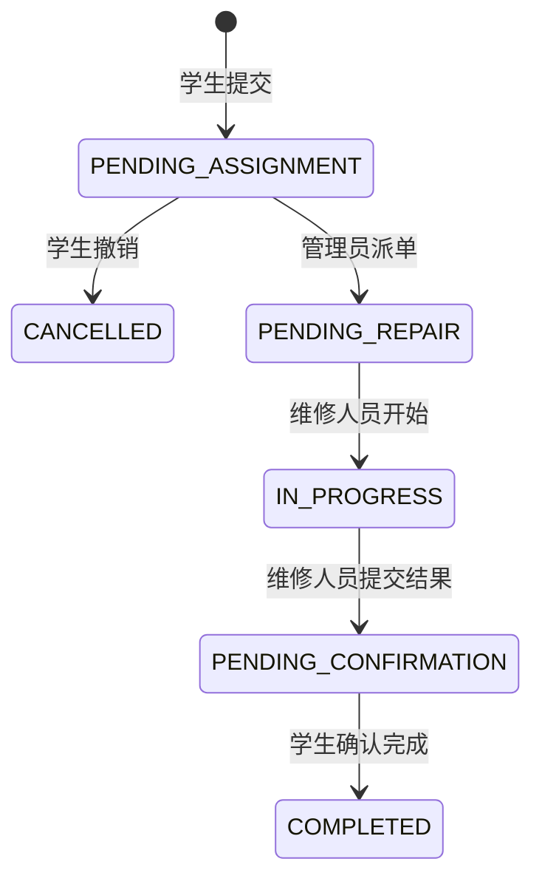
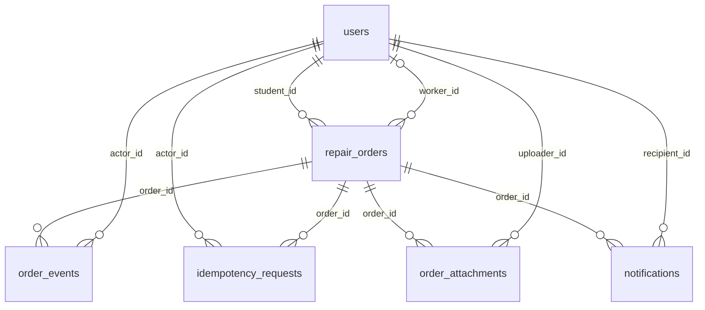

# FixCampus 系统架构与数据模型

FixCampus 采用前后端同源分离的单体架构：**React 19 / TypeScript / Vite** 前端工作台（挂载于 `/app/`，含最小 PWA 应用壳）通过同源 `/api/v1` 与 **Spring Boot 3.5 / MySQL 8.4** 后端交互。

## 整体分层与职责

- **安全与入口**：[ApiSecurityConfig](../../src/main/java/com/fixcampus/api/v1/ApiSecurityConfig.java) 基于服务端 Servlet Session、`HttpOnly` / `SameSite=Lax` Cookie、CSRF 令牌与同源 `Origin` 校验保护 `/api/v1/**`；[ApiRateLimitFilter](../../src/main/java/com/fixcampus/api/v1/ApiRateLimitFilter.java) 对登录及业务写路由执行进程内限流（`429`）；[ApiRequestIdFilter](../../src/main/java/com/fixcampus/api/v1/ApiRequestIdFilter.java) 透传 `X-Request-Id` 关联脱敏日志。
- **读/写分离查询路径**：列表分页（[StudentOrders](../../src/main/java/com/fixcampus/api/v1/StudentOrders.java)、[OperationalOrders](../../src/main/java/com/fixcampus/api/v1/OperationalOrders.java)）与管理员统计聚合（[AdminStatisticsService](../../src/main/java/com/fixcampus/service/AdminStatisticsService.java)）采用 JDBC 只读查询；工单状态变更使用 JPA 事务与 `PESSIMISTIC_WRITE` 悲观行锁（`innodb_lock_wait_timeout = 3s`），同事务写入 `order_events` 与幂等 `notifications`（[NotificationService](../../src/main/java/com/fixcampus/service/NotificationService.java)）。
- **持久化幂等与附件存储**：新建报修在同事务写入 `idempotency_requests`，唯一键冲突回滚后回查已提交结果；[AttachmentImages](../../src/main/java/com/fixcampus/service/AttachmentImages.java) 与 [AttachmentStorage](../../src/main/java/com/fixcampus/service/AttachmentStorage.java) 基于纯 JDK `ImageIO` 完成魔数与像素校验、无 EXIF 重编码及托管目录落盘，通过写串行化与行锁管控配额，并在事务提交/回滚回调中清理磁盘文件。
- **数据库迁移**：通过 Flyway `V1～V6` 管理六张业务表，[IsolatedMigrationConfig](../../src/main/java/com/fixcampus/config/IsolatedMigrationConfig.java) 在 `web-slice` 模式下防止误接管非空未受管 schema。

## 工单状态机

## 数据库 ER 模型（Flyway `V1～V6`）

| 迁移版本 | 表名 | 核心职责与约束 |
| --- | --- | --- |
| [V1](../../src/main/resources/db/migration/V1__create_users.sql) | `users` | 三角色、ASCII 小写用户名唯一、PBKDF2 密码哈希、姓名与可选联系方式 |
| [V2](../../src/main/resources/db/migration/V2__create_repair_orders.sql) | `repair_orders` | 学生/维修员外键、六状态与分类、状态与完成时间 `CHECK`、角色/分页索引 |
| [V3](../../src/main/resources/db/migration/V3__create_order_events.sql) | `order_events` | 动作、操作人角色/姓名快照、微秒时间；`(order_id, action)` 唯一 |
| [V4](../../src/main/resources/db/migration/V4__create_idempotency.sql) | `idempotency_requests` | `actor_id` 外键、`(actor_id, operation_code, request_key)` 唯一、请求摘要、关联工单 ID |
| [V5](../../src/main/resources/db/migration/V5__create_order_attachments.sql) | `order_attachments` | `storage_key` 唯一、真实 MIME/宽高/SHA-256、`ON DELETE RESTRICT` 外键 |
| [V6](../../src/main/resources/db/migration/V6__create_notifications.sql) | `notifications` | `idempotency_key` 唯一、事件白名单与去空格 `CHECK`、接收人/未读/工单索引 |

配置与接口入口：[application-web-slice.yml](../../src/main/resources/application-web-slice.yml) · [StudentApi](../../src/main/java/com/fixcampus/api/v1/StudentApi.java) · [OrderOperationsApi](../../src/main/java/com/fixcampus/api/v1/OrderOperationsApi.java) · [AdminStatisticsApi](../../src/main/java/com/fixcampus/api/v1/AdminStatisticsApi.java) · [OrderAttachmentsApi](../../src/main/java/com/fixcampus/api/v1/OrderAttachmentsApi.java) · [NotificationsApi](../../src/main/java/com/fixcampus/api/v1/NotificationsApi.java) · [实现与测试索引](IMPLEMENTATION.md)。
