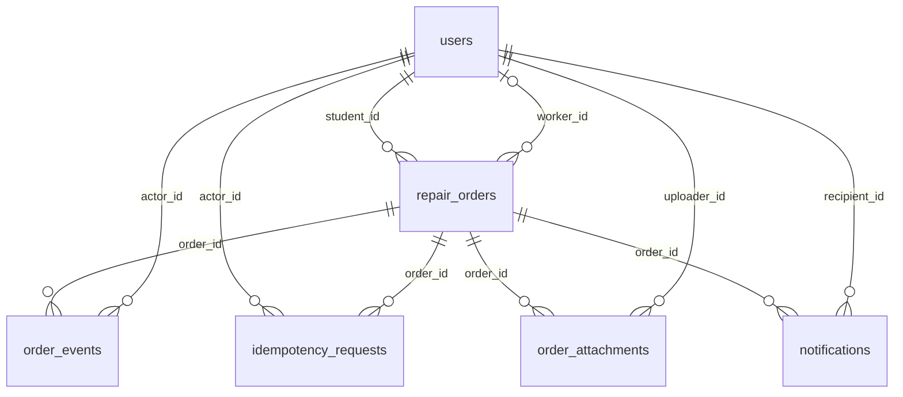
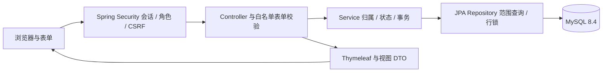
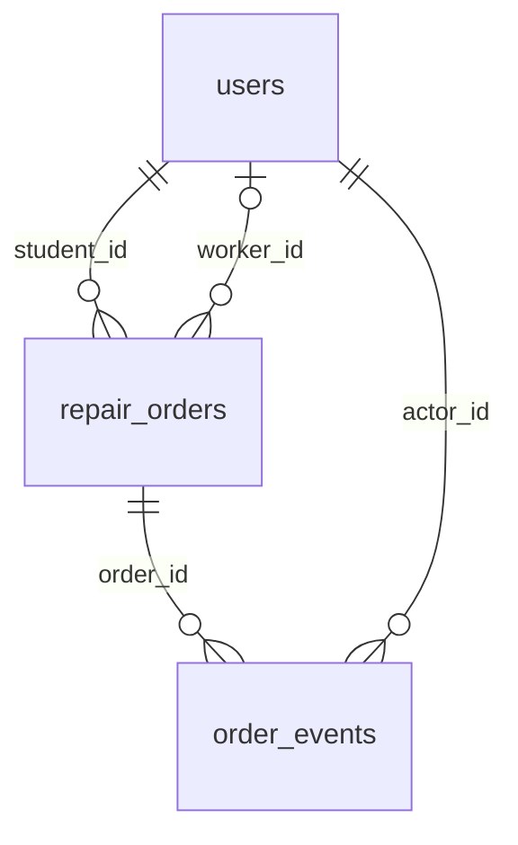

# FixCampus 系统架构与数据模型

## 当前 Web/PWA 架构与六表模型（2026-11-26）

应用采用共享单体后端，React 19 / TypeScript 工作台（挂载于 `/app/`，含最小 PWA 应用壳）通过同源 `/api/v1` 访问真实业务，原 SSR 路径继续兼容 Controller / Thymeleaf。

- **安全与入口**：[ApiSecurityConfig](../../src/main/java/com/fixcampus/api/v1/ApiSecurityConfig.java) 使用服务端 Servlet Session、CSRF 与同源 `Origin` 校验，[ApiRateLimitFilter](../../src/main/java/com/fixcampus/api/v1/ApiRateLimitFilter.java) 在鉴权之后保护登录与显式业务写路由（不含退出登录），[ApiRequestIdFilter](../../src/main/java/com/fixcampus/api/v1/ApiRequestIdFilter.java) 透传 `X-Request-Id`。`web-slice` / `demo` / `prod` Profile 默认禁用注册、设置会话锁等待超时 `innodb_lock_wait_timeout = 3`，并将根路径 `/` 重定向至 `/app/`。
- **读/写分离路径**：列表分页（[StudentOrders](../../src/main/java/com/fixcampus/api/v1/StudentOrders.java)、[OperationalOrders](../../src/main/java/com/fixcampus/api/v1/OperationalOrders.java)）与管理员统计聚合（[AdminStatisticsService](../../src/main/java/com/fixcampus/service/AdminStatisticsService.java)）使用 JDBC 只读查询；工单状态变更沿用 JPA 事务与悲观行锁，同事务写入 `order_events` 与幂等 `notifications`（[NotificationService](../../src/main/java/com/fixcampus/service/NotificationService.java)）；新建报修在同一事务写入 `idempotency_requests`，唯一键冲突回滚后回查已提交结果。
- **图片附件与演示重置**：[OrderAttachments](../../src/main/java/com/fixcampus/api/v1/OrderAttachments.java)、[AttachmentImages](../../src/main/java/com/fixcampus/service/AttachmentImages.java) 与 [AttachmentStorage](../../src/main/java/com/fixcampus/service/AttachmentStorage.java) 基于纯 JDK `ImageIO` 完成 PNG/JPEG 魔数与尺寸/总像素预检、无 EXIF 重编码及托管目录落盘，数量与总量配额结合进程内写串行化与工单行锁校验，磁盘清理通过事务提交/回滚回调执行并对失败项入队补偿。[DemoResetService](../../src/main/java/com/fixcampus/service/DemoResetService.java) 在双重显式开关下在数据库单事务内按外键顺序重置示例数据（保留三角色预置账号），提交后再清理磁盘附件。
- **数据库迁移**：`web-slice` / `demo` / `prod` 通过 Flyway `V1～V6` 管理隔离库，包含六张业务表与迁移历史表；[IsolatedMigrationConfig](../../src/main/java/com/fixcampus/config/IsolatedMigrationConfig.java) 在 `web-slice` 下拒绝接管非空未受管 schema。

| 迁移版本 | 表 | 核心职责与约束 |
| --- | --- | --- |
| [V1](../../src/main/resources/db/migration/V1__create_users.sql) | `users` | 三角色、ASCII 小写用户名唯一、PBKDF2 密码哈希、姓名与可选联系方式 |
| [V2](../../src/main/resources/db/migration/V2__create_repair_orders.sql) | `repair_orders` | 学生/维修员外键、六状态与分类、状态与完成时间 `CHECK`、角色/分页索引 |
| [V3](../../src/main/resources/db/migration/V3__create_order_events.sql) | `order_events` | 动作、操作人角色/姓名快照、微秒时间；`(order_id, action)` 唯一 |
| [V4](../../src/main/resources/db/migration/V4__create_idempotency.sql) | `idempotency_requests` | `actor_id` 外键、`(actor_id, operation_code, request_key)` 唯一、请求摘要、关联结果工单 ID |
| [V5](../../src/main/resources/db/migration/V5__create_order_attachments.sql) | `order_attachments` | `storage_key` 唯一、真实 MIME/宽高/SHA-256、`ON DELETE RESTRICT` 外键 |
| [V6](../../src/main/resources/db/migration/V6__create_notifications.sql) | `notifications` | `idempotency_key` 唯一、事件白名单与去空格 `CHECK`、接收人/未读/工单索引 |

配置与核心接口入口：[application-web-slice.yml](../../src/main/resources/application-web-slice.yml) · [StudentApi](../../src/main/java/com/fixcampus/api/v1/StudentApi.java) · [OrderOperationsApi](../../src/main/java/com/fixcampus/api/v1/OrderOperationsApi.java) · [AdminStatisticsApi](../../src/main/java/com/fixcampus/api/v1/AdminStatisticsApi.java) · [OrderAttachmentsApi](../../src/main/java/com/fixcampus/api/v1/OrderAttachmentsApi.java) · [NotificationsApi](../../src/main/java/com/fixcampus/api/v1/NotificationsApi.java)。

## 原 SSR 架构与三表模型

以下说明对应原服务端页面与手工 SQL 路径，SSR 创建表单的能力按该入口解释。

FixCampus 是独立完成的个人课程实践项目。依据当前 Controller、Service、Repository、实体和三份 DDL 整理已有设计。采用单体应用与服务端页面，没有微服务、Redis、消息队列或生产部署声明。

## 请求与事务边界

`open-in-view=false`，查询组装 DTO 后渲染；写操作在事务内完成。入口见 [SecurityConfig](../../src/main/java/com/fixcampus/config/SecurityConfig.java)、[RepairOrderService](../../src/main/java/com/fixcampus/service/RepairOrderService.java)、[RepairOrderRepository](../../src/main/java/com/fixcampus/repository/RepairOrderRepository.java)。

## 工单状态机

写前锁定工单并核对角色、对象归属和最新状态；工单及事件在同一事务提交。取消只在待分派，完成时间只在学生确认后写入。不支持改派或返修。状态冲突返回 409，存储故障返回 503；创建报修尚无服务端幂等键。

## 三表关系

工单的 student_id 必填、worker_id 可空且受状态 CHECK 约束；两者是不同外键。以 [001-users.sql](../../database/001-users.sql) → [002-repair-orders.sql](../../database/002-repair-orders.sql) → [004-order-events.sql](../../database/004-order-events.sql) 为真实初始化顺序。

| 表 | 内容与约束 |
| --- | --- |
| users | 三角色、ASCII 小写用户名唯一、密码哈希、姓名及可选联系方式 |
| repair_orders | 学生/维修人员外键、六状态、分类、非空业务内容、完成时间与状态 CHECK、按角色/状态及创建顺序索引 |
| order_events | 操作人、角色/姓名快照、动作、微秒时间、可选说明；每工单每动作唯一，动作/角色 CHECK |

事件按工单 CASCADE 清理，操作人 RESTRICT；应用没有删除工单或编辑历史入口，但 DML 账号并非数据库级不可篡改。旧工单不补造过程时间；真实事件缺失时明确显示未记录。新增改派或返修前必须重新评估事件唯一约束。验证证据与局限见[实现与测试导览](IMPLEMENTATION.md)。
