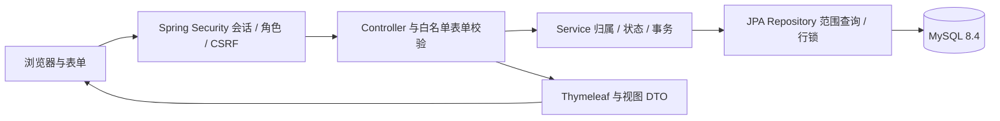
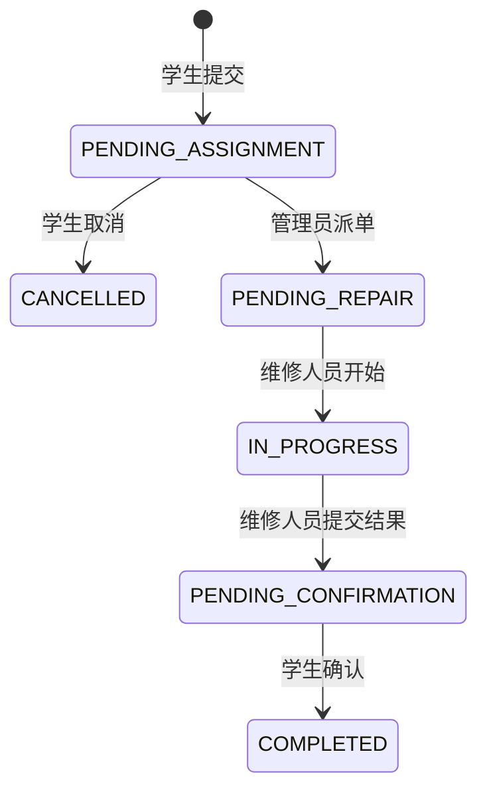
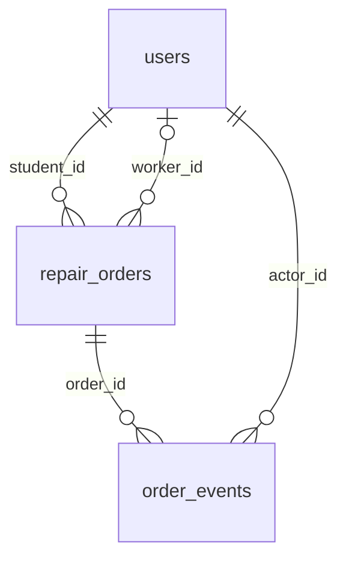

# FixCampus 系统架构与数据模型

FixCampus 是独立完成的个人课程实践项目。依据当前 Controller、Service、Repository、实体和三份 DDL 整理已有设计。采用单体应用与服务端页面，没有微服务、Redis、消息队列或生产部署声明。

## 请求与事务边界

`open-in-view=false`，查询组装 DTO 后渲染；写操作在事务内完成。入口见 [SecurityConfig](../../src/main/java/com/fixcampus/config/SecurityConfig.java)、[RepairOrderService](../../src/main/java/com/fixcampus/service/RepairOrderService.java)、[RepairOrderRepository](../../src/main/java/com/fixcampus/repository/RepairOrderRepository.java)。

## 工单状态机

写前锁定工单并核对角色、对象归属和最新状态；工单及事件在同一事务提交。取消只在待分派，完成时间只在学生确认后写入。不支持改派或返修。状态冲突返回 409，存储故障返回 503；创建报修尚无服务端幂等键。

## 三表关系

工单的 student_id 必填、worker_id 可空且受状态 CHECK 约束；两者是不同外键。以 [001-users.sql](../../database/001-users.sql) → [002-repair-orders.sql](../../database/002-repair-orders.sql) → [004-order-events.sql](../../database/004-order-events.sql) 为真实初始化顺序。

| 表 | 内容与约束 |
| --- | --- |
| users | 三角色、ASCII 小写用户名唯一、密码哈希、姓名及可选联系方式 |
| repair_orders | 学生/维修人员外键、六状态、分类、非空业务内容、完成时间与状态 CHECK、按角色/状态及创建顺序索引 |
| order_events | 操作人、角色/姓名快照、动作、微秒时间、可选说明；每工单每动作唯一，动作/角色 CHECK |

事件按工单 CASCADE 清理，操作人 RESTRICT；应用没有删除工单或编辑历史入口，但 DML 账号并非数据库级不可篡改。旧工单不补造过程时间；真实事件缺失时明确显示未记录。新增改派或返修前必须重新评估事件唯一约束。验证证据与局限见[实现与测试导览](IMPLEMENTATION.md)。
