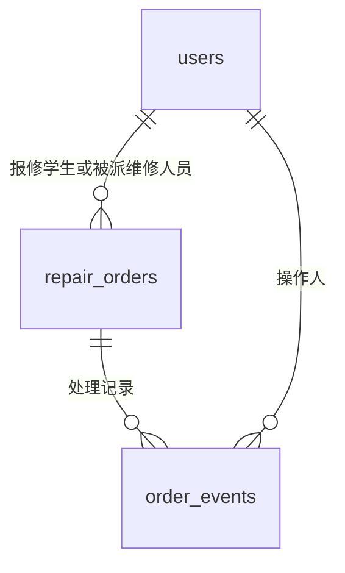

# FixCampus 实现与验证依据

FixCampus 是个人主导、AI 辅助开发的课程与工程实践项目。本页以当前源码和测试为依据介绍实际实现，不宣称生产部署、已完成正式漏洞审计或已启用强制分支保护。

## 分层与数据库

浏览器提交表单后，Spring Security 负责身份、角色入口和 CSRF；Controller 白名单绑定表单，Service 校验角色、归属、状态并管理事务，Repository 执行范围查询与锁定读取，MySQL 维护数据库约束。Thymeleaf 输出视图 DTO；`open-in-view=false`，避免在模板渲染阶段意外延长数据访问。

分层及数据模型见[系统架构](ARCHITECTURE.md)，依据现有源码与三份建表 SQL 整理：

图中合并表达 users 与工单的角色关系；实际 `student_id` 必填、`worker_id` 可空，是两个不同外键，具体基数和状态约束以 DDL 为准。

| 表 | 职责与主要约束 | 源码 |
| --- | --- | --- |
| users | 角色、用户名唯一、密码哈希、姓名与可选联系方式 | [001-users.sql](../../database/001-users.sql) · [User](../../src/main/java/com/fixcampus/entity/User.java) |
| repair_orders | 学生/维修人员外键，六状态、字段长度和状态字段一致性约束 | [002-repair-orders.sql](../../database/002-repair-orders.sql) · [RepairOrder](../../src/main/java/com/fixcampus/entity/RepairOrder.java) |
| order_events | 动作、时间、当次角色/姓名快照；每单每动作唯一，动作与角色匹配 | [004-order-events.sql](../../database/004-order-events.sql) · [OrderEvent](../../src/main/java/com/fixcampus/entity/OrderEvent.java) |

数据库外键不替代业务角色检查；事件记录没有应用层编辑/删除入口，但应用账号仍有 DML 权限，不能宣称数据库级不可篡改审计。当前唯一事件约束服务于不改派、不返修的单向状态机，扩展这些业务时需重新评估。

## 认证与数据归属

- [SecurityConfig](../../src/main/java/com/fixcampus/config/SecurityConfig.java) 对 `/student/**`、`/admin/**`、`/worker/**` 设置角色限制；表单登录使用服务端会话，登录变更 Session ID，退出清除会话；密码为带算法标识的 PBKDF2 哈希。
- [CampusUserDetailsService](../../src/main/java/com/fixcampus/security/CampusUserDetailsService.java) 规范化并校验用户名，[RoleLoginSuccessHandler](../../src/main/java/com/fixcampus/security/RoleLoginSuccessHandler.java) 根据数据库角色确定登录后入口，不接受客户端指定角色或跳转地址。
- [RepairOrderRepository](../../src/main/java/com/fixcampus/repository/RepairOrderRepository.java) 的学生/维修人员查询含身份范围；[RepairOrderService](../../src/main/java/com/fixcampus/service/RepairOrderService.java) 写入前再次核对角色和对象归属。本人范围内不存在或不可访问的工单按 404 处理，不能靠替换 URL 编号扩大范围。

验证入口：[UserAuthenticationIntegrationTest](../../src/test/java/com/fixcampus/UserAuthenticationIntegrationTest.java) 的 `roleLoginNormalizesUsernameIgnoresForgedRoleAndRejectsCrossRoleRequests`、`loginChangesSessionIdAndErasesCredentialHashFromSessionPrincipal`；[OrderSearchIntegrationTest](../../src/test/java/com/fixcampus/OrderSearchIntegrationTest.java) 的 `foreignIdsAndForgedIdentityParametersCannotExpandSearchOrCounts`。这些是已存在的方法，不代表穷尽所有授权组合。

## 输入与输出安全

[StudentController](../../src/main/java/com/fixcampus/controller/StudentController.java) 只绑定地点、分类和描述，系统字段从会话及服务器生成；普通注册在 [UserService](../../src/main/java/com/fixcampus/service/UserService.java) 固定为 STUDENT。其他写操作也有各自允许字段，不能直接绑定实体任意字段。

[RepairOrderForm](../../src/main/java/com/fixcampus/form/RepairOrderForm.java) 规范化 CRLF/CR，配合 [CodePointLengthValidator](../../src/main/java/com/fixcampus/validation/CodePointLengthValidator.java) 按 Unicode 码点计数，避免表情或换行造成前后端长度差异。Thymeleaf 使用转义文本而非将用户输入当 HTML 执行；注册失败不回显密码。CSRF 保持启用，包括登录、注册和 POST 退出。

验证入口：

- [UserAuthenticationIntegrationTest](../../src/test/java/com/fixcampus/UserAuthenticationIntegrationTest.java)：`registrationNormalizesSafeFieldsHashesPasswordAndIgnoresSystemFields`、`csrfProtectsAllPublicWritesAndLogoutInvalidatesOnlyCurrentSession`。
- [StudentRepairIntegrationTest](../../src/test/java/com/fixcampus/StudentRepairIntegrationTest.java)：`createUsesSessionIdentityAndSystemFieldsAndFlashIsOnceOnly`、`ownDetailEscapesHtmlAndDoesNotExposeWorkerContactsOrHashes`。
- [OrderSearchIntegrationTest](../../src/test/java/com/fixcampus/OrderSearchIntegrationTest.java)：`exactIdNumericLocationAndLikeMetacharactersHaveDefinedSemantics`，覆盖 LIKE 元字符作为字面输入的查询语义。

## 事务状态与处理记录

工单的取消、派单、开始、提交结果和确认均在事务中锁定目标行后检查最新状态。Repository 使用 `@Lock(PESSIMISTIC_WRITE)`；Service 用 `@Transactional` 包住状态修改及事件保存。完成时间只在学生确认时写入。

重复状态流转或状态竞争按 409 处理；锁超时也按冲突反馈。连接、数据访问或提交错误按 503 处理，避免在事务失败后仍返回成功提示。[GlobalExceptionHandler](../../src/main/java/com/fixcampus/exception/GlobalExceptionHandler.java) 不输出原始 SQL 错误或用户请求数据。报修创建没有服务端提交幂等键，不能把上述状态保护解释为“网络重试不会重复创建工单”。

| 解决的问题 | 真实测试入口 |
| --- | --- |
| 并发派单不能覆盖另一个人的处理 | [AdminOrderIntegrationTest](../../src/test/java/com/fixcampus/AdminOrderIntegrationTest.java) · `concurrentAssignmentsToDifferentWorkersHaveExactlyOneWinner` |
| 取消与派单以事务实际提交顺序为准 | 同上 · `assignmentAndCancellationRespectWhicheverTransactionCommitsFirst` |
| 真正的 MySQL 行锁等待超时不产生变更 | 同上 · `realMySqlAssignmentLockTimeoutLeavesOrderUnassigned` |
| 状态与已 flush 事件一并回滚 | [OrderHistoryIntegrationTest](../../src/test/java/com/fixcampus/OrderHistoryIntegrationTest.java) · `explicitTransactionRollbackRestoresStatusAndFlushedEventTogether` |
| 并发确认仅追加一次事件 | 同上 · `simultaneousConfirmationsAppendExactlyOneConfirmation` |
| 数据库/提交异常不能显示确认成功 | [OrderFailureHandlingTest](../../src/test/java/com/fixcampus/OrderFailureHandlingTest.java) · `confirmationDatabaseAndCommitFailuresReturn503WithoutSuccessFlash`（Mock 故障测试） |
| 并发同名注册只成功一个 | [UserAuthenticationIntegrationTest](../../src/test/java/com/fixcampus/UserAuthenticationIntegrationTest.java) · `concurrentDuplicateRegistrationsCommitExactlyOneAccount` |

[OrderHistory](../../src/main/java/com/fixcampus/view/OrderHistory.java) 对旧数据缺失的中间事件显示未记录，只引用确实存在的提交/完成字段，不伪造时间或操作人。它表达业务处理过程，不是完整的安全审计日志系统。

## 可重复的测试与 CI

[RealMySqlTestSupport](../../src/test/java/com/fixcampus/RealMySqlTestSupport.java) 在启动时检查数据库产品为 MySQL 且实际 schema 符合 `fixcampus_*_test`；测试清理只处理自己建立的夹具。真实数据库测试覆盖事务、外键、唯一约束和锁；Mock 故障测试补充难以稳定制造的连接或提交失败，不能把 Mock 结果说成真实数据库故障演练。

[现有 CI](../../.github/workflows/ci.yml) 在 Ubuntu 24.04 上运行 JDK 25、Maven 3.9.16、MySQL 8.4.11，按 001→002→004 初始化，使用非 root 单库 DML 账号且关闭演示初始化。Maven 失败保持 Job failure，收集与上传以 always 条件尽可能保存诊断；成功时拒绝缺失、损坏或空的必要报告。

测试与覆盖率数据应以本仓库 `main` 的 GitHub Actions Run 和 Surefire/JaCoCo 报告为准，不以其他仓库的历史数字代替。

完整 HTTP 闭环的阅读入口是 [SystemWorkflowIntegrationTest](../../src/test/java/com/fixcampus/SystemWorkflowIntegrationTest.java) 的 `registeredStudentCompletesLifecycleThroughRealCookieSessions`，通过真实 Cookie 会话完成学生提交、管理员分派、维修处理和学生确认；`realSessionsEnforceRoleAndOwnershipBeforeReadingOrMutatingOrders` 验证真实会话下的权限边界。

本仓库采用 `main` 推送 CI 与人工审查，不宣称原生 Required Status Checks、生产部署或尚未完成的工程优化已经实现。
